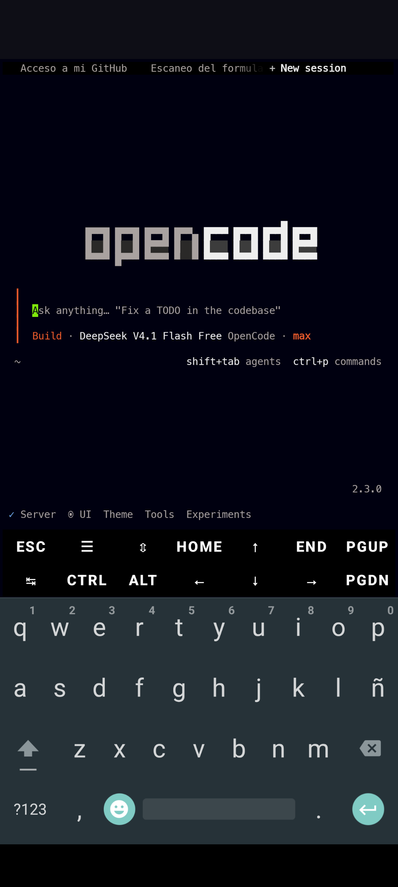

<!--
  Keep this document aligned with README.md, README.es.md, README.fr.md,
-->

<p align="center">
  
</p>

<h1 align="center">OpenCode for Termux</h1>

<p align="center">
  <strong>OpenCode AI coding agent running natively on Android with Termux.</strong><br>
  Android/Bionic runtimes for ARM64 and x86_64 · SHA-256 verification · managed installation
</p>

<p align="center">
  <a href="./README.md">Español</a> · <a href="./README.en.md">English</a> · <a href="./README.fr.md">Français</a>
</p>

<p align="center">
  <a href="https://github.com/C04-wq/opencode-termux/releases/latest"></a>
  <a href="https://github.com/C04-wq/opencode-termux/actions/workflows/validate.yml"></a>
  <a href="./LICENSE"></a>
</p>

<p align="center">
  <a href="#-about-the-project">About</a> ·
  <a href="#-requirements">Requirements</a> ·
  <a href="#-installation">Installation</a> ·
  <a href="#-updates">Updates</a> ·
  <a href="#-technical-overview">Technical overview</a> ·
  <a href="#-troubleshooting">Troubleshooting</a>
</p>

---

## 📱 About the project

OpenCode is an open-source AI coding agent for the terminal. This repository packages it for Android Termux using Termux's native Bionic environment and Bun.

The runtime is a JavaScript bundle executed by Termux Bun, with OpenTUI, the `bun-pty` shared library, the official `opencode-pty` daemon built from `packages/process-daemon`, and the file-watcher module. It does not execute the upstream Linux/musl ELF binary and does not require PRoot, a Linux VM, Node.js or npm on the device.

> [!IMPORTANT]
> This is an unofficial, community-maintained Termux adaptation. OpenCode itself is developed by anomalyco/opencode. This repository maintains the Termux installer, integration, update manager and validation.

### Highlights

- Native Android/Bionic runtimes for ARM64/aarch64 and x86_64 Termux (Android 9 / API 28 or newer).
- Bun-based JavaScript bundle with Android/Bionic OpenTUI, `bun-pty`, the official Rust `opencode-pty` daemon and file watching.
- SHA-256-pinned release asset, validated before extraction.
- Automatic installation of missing Termux dependencies: bun, ripgrep and libc++.
- Automatic update at normal session launch, at most once every six hours, with runtime and SHA-256 verification.

## 📸 Screenshots

<p align="center">
  
  
</p>
<p align="center">
  
  
</p>

## ⚙️ Requirements

| Requirement | Details |
| --- | --- |
| Device | Android 9 (API 28) or newer running Termux |
| Architecture | ARM64 / aarch64 and x86_64 |
| Runtime dependencies | Termux packages bun, ripgrep and libc++ (installed automatically if missing) |
| Installer tools | Bash, Git, curl, tar, sed and sha256sum |
| Termux support files | CA certificate bundle and resolver configuration |
| Network | Internet access for installation, pinned release downloads, update checks and AI providers |

The one-line installer requires curl to be installed already. It uses Termux pkg to install missing dependencies and support packages.

### Unsupported environments

32-bit ARM, 32-bit x86 Android, non-Termux Android shells, desktop Linux, macOS and Windows are not supported.

## 🚀 Installation

1. Install and open Termux from a trusted source.
2. Open the Termux terminal.
3. Run:

```bash
curl -fsSL https://raw.githubusercontent.com/C04-wq/opencode-termux/main/install.sh | bash
```

4. When the installer finishes, launch OpenCode:

```bash
opencode
```

Check the installed version or available OpenCode options:

```bash
opencode --version
opencode --help
```

### What happens during installation?

The installer performs the following operations:

1. **Checks the platform.** It accepts `uname -m` values `aarch64` and `x86_64`.
2. **Prepares the project checkout.** For a piped installation, it uses `$PREFIX/opt/opencode-termux`. If it finds an existing clean clone of this repository in a common location under the Termux home directory, it updates that clone and moves it to the managed location where possible.
3. **Protects local work.** A discovered checkout with modified or untracked files is not overwritten; the installer stops and tells you to commit or stash the changes.
4. **Prepares dependencies.** It installs missing Git, curl, tar, coreutils, CA certificates and resolver support through `pkg`.
5. **Reads the release metadata.** The expected OpenCode version and archive SHA-256 digest come from `release-checksums.json` in the checked-out repository.
6. **Downloads the release.** It downloads the Android bundle for the detected architecture from this repository's GitHub Releases over HTTPS.
7. **Verifies the download.** It calculates SHA-256 and refuses to continue if the digest does not match the pinned metadata.
8. **Validates the archive layout.** It rejects unexpected files, duplicate entries, path traversal, unsafe links and incorrect file types before extraction.
9. **Stages the native bundle.** It prepares the Bun launcher, JavaScript module graph and Android libraries in a temporary location.
10. **Activates and tests.** It installs the native bundle and project launchers, then checks the version through Termux Bun.
11. **Protects the previous installation.** The old runtime and launchers are retained during activation and restored when the final activation/test path fails.

Successful setup commands are kept quiet to make the output readable. If a command fails, its captured output is printed to help diagnose the problem.

### Existing installations and conflict handling

The installer is deliberately conservative: it does not delete a command or package just because its name contains “OpenCode”.

It can replace recognized installations when ownership can be established:

- The legacy global npm package `opencode-termux` is removed only when its package metadata is valid and the existing `opencode` symlink resolves inside that package.
- A short allowlist of Termux/dpkg package owners is recognized through package ownership metadata: `opencode`, `opencode1`, `opencode-termux`, `opencode-wrapper` and `opencode1-wrapper`.
- A previous project-managed `opencode`, `internal update helper` or `opencode-termux` launcher is replaced after its contents are recognized.

If an existing command is unknown, manually copied, or cannot be safely attributed to one of those installations, the installer stops and leaves it untouched. Identify and remove that installation yourself only after confirming its origin. It does not perform a broad cleanup of every similarly named file (for example, arbitrary `opencode2` binaries), unrelated npm packages, or unrelated directories.

The installer also does not remove OpenCode settings, sessions, projects or provider credentials.

### Installation locations

The default managed layout is:

| Component | Path |
| --- | --- |
| Project checkout | `$PREFIX/opt/opencode-termux` |
| OpenCode runtime and libraries | `$PREFIX/lib/opencode-termux/` |
| OpenCode command | `$PREFIX/bin/opencode` |
| Installed version marker | `$PREFIX/lib/opencode-termux/.opencode-termux-version` |
| Installed bundle SHA-256 | `$PREFIX/lib/opencode-termux/.opencode-termux-archive-sha256` |
| Checkout path marker | `$PREFIX/lib/opencode-termux/.opencode-termux-repo-dir` |

In Termux, `$PREFIX` normally resolves to `/data/data/com.termux/files/usr`. The only public command installed is `opencode`.

Keep the managed checkout in place: the update command uses it to retrieve repository changes and rerun the installer.

## 🔄 Updates

OpenCode keeps its official CLI commands. To update manually, use the built-in command:

```bash
opencode update
```

In OpenCode, `update` is an alias for `upgrade`. In this Termux adaptation, both use the patched built-in updater to query verified releases from this repository. It checks the version, architecture and SHA-256 before running the installer. It never falls back to an upstream release when a verified package is unavailable.

The launcher also checks for a newer release automatically, at most once every six hours. The internal helper is stored inside the runtime and does not install additional commands in `$PREFIX/bin`. Disable the automatic check with `OPENCODE_TERMUX_AUTOUPDATE=0`. Logs are written to `$PREFIX/var/log/opencode-termux/auto-update.log`.

To repair or reinstall the runtime, rerun the installer:

```bash
curl -fsSL https://raw.githubusercontent.com/C04-wq/opencode-termux/main/install.sh | bash
```
## 🧩 Technical overview

### Runtime architecture

The installed runtime is stored in $PREFIX/lib/opencode-termux/lib/opencode and launched through $PREFIX/lib/opencode-termux/bin/opencode. The launcher executes Termux Bun. The bundle includes Bionic Android modules for OpenTUI, Rust PTY and @parcel/watcher.

This replaces the former Linux/musl approach: the installer no longer patches or executes a Linux ELF binary. Android shared libraries must be ELF shared objects for the target architecture (AArch64 or x86-64, ET_DYN) without glibc dependencies.

### Pinned runtime source

The `check-upstream.yml` and `prepare-upstream-update.yml` workflows check official stable `vX.Y.Z` tags from anomalyco/opencode every six hours and compare semantic versions across all major releases. When a newer release appears, they prepare a draft PR with the exact source commit and SHA-256 digest. The validation workflow builds independent ARM64 and x86_64 runtimes, inspects their ELF libraries, validates both archives and runs smoke tests. Installer metadata is not changed and no release is published automatically; the candidate must be reviewed and approved before publication. This repository's pipeline builds OpenCode from a pinned commit of the official source (anomalyco/opencode). GitHub Actions builds OpenTUI, `bun-pty`, the official Rust daemon `opencode-pty` from `packages/process-daemon`, and the Android/Bionic watcher before preparing the JavaScript bundle, inspects the ELF modules, and verifies the archive and its SHA-256 digest. tools/supply-chain-lock.json records source and tool revisions. The installer downloads the release selected by release-checksums.json; that metadata will remain pinned to the previously verified runtime until the new build passes the automated ARM64 and x86_64 builds, ELF checks, archive validation and runtime smoke tests in CI.

The bundle contains a shell launcher, the JavaScript module graph, a Bionic OpenTUI renderer, the `bun-pty` shared library, the official `opencode-pty` daemon executable and an Android file-watcher module.

### Installation and rollback

1. Check for ARM64/aarch64 or x86_64 and Android API compatibility.
2. Install missing bun, ripgrep and libc++ packages through Termux pkg.
3. Download the pinned Android bundle over HTTPS and verify SHA-256.
4. Validate archive paths and member types before extraction; reject traversal, links and special files.
5. Replace the build-time prefix placeholder with the managed runtime path.
6. Stage the bundle and preserve the previous runtime and launchers until activation.
7. Run the installed launcher's --version check and roll back if it fails.


The launcher compares the OpenCode version, runtime-generation marker and installed bundle SHA-256. This detects both the musl-to-Bionic migration and a rebuilt bundle that keeps the same version and runtime generation.

The automatic update check and its helper remain internal to the runtime; no additional public command is installed.

## 🔐 Security and integrity

- Downloads use HTTPS and are checked against the SHA-256 digest committed in this repository.
- The source repository and release tag are allowlisted and must match the pinned version.
- Archive paths and member types are checked before extraction; symbolic links, hardlinks, traversal and special files are rejected.
- CI checks native modules for the target AArch64 or x86-64 ELF shared-object format and absence of glibc dependencies.
- The installer does not overwrite unrecognized Termux commands.
- Runtime and launcher activation is transactional, with rollback if the final version check fails.
- The uninstaller verifies project ownership before removing managed files.

Trust boundary: source revisions and build tools are pinned and every artifact is verified, but SHA-256 is not an independent signature and does not replace auditing the code and build chain. Third-party-derived compatibility components and their required license notices are documented in THIRD_PARTY_NOTICES.md.

## 🤖 Release automation and CI

The `check-upstream.yml` and `prepare-upstream-update.yml` workflows check official stable `vX.Y.Z` tags from anomalyco/opencode every six hours, comparing semantic versions across all major releases. When a newer version appears, they prepare a draft PR containing the exact source commit and SHA-256 digest. The `validate.yml` workflow builds and validates independent ARM64 and x86_64 bundles, inspects their ELF libraries, validates both archives and runs automated smoke tests. Candidate preparation does not change `release-checksums.json` or publish a release automatically; the candidate must be reviewed and approved before a release is created.


CI independently builds and validates ARM64 and x86_64 bundles, inspects their ELF libraries, validates both archives and runs automated runtime smoke tests. These reproducible checks are the acceptance gate for both architectures and do not require physical devices. Additional testing on real devices is useful, but it does not block automated preparation.

For optional manual device testing, download the matching `android-arm64-candidate-*` or `android-x86_64-candidate-*` GitHub Actions artifact and pass its archive to `scripts/test-termux-device.sh`. This is additional validation, not a requirement for automated CI acceptance. The script installs the candidate into a separate directory under `$PREFIX/opt` and does not replace the current installation. Then launch the candidate and verify interactive TUI, PTY, file watching and the background server; remove the candidate directory when finished.

Installer metadata is changed only after a release has passed the source build, ELF, archive and SHA-256 checks. This project no longer builds or publishes the incompatible Linux/musl executable.
## 🛠️ Troubleshooting

### `opencode: command not found`

Check whether the managed launcher exists and rerun the installer:

```bash
ls -l "$PREFIX/bin/opencode"
bash "$PREFIX/opt/opencode-termux/install.sh"
hash -r
opencode --version
```

You can also rerun the one-line curl installer. It detects and reuses the managed checkout.

### `permission denied`

The installer sets mode `755` on the OpenCode launcher after placing it in its final path. Rerun the installer to repair these permissions:

```bash
bash "$PREFIX/opt/opencode-termux/install.sh"
ls -l "$PREFIX/bin/opencode" "$PREFIX/bin/opencode-termux" "$PREFIX/lib/opencode-termux/update-runtime.sh"
```

### Unsupported architecture

Check the architecture reported by Termux:

```bash
uname -m
dpkg --print-architecture
```

The supported device must report `aarch64` or `x86_64`. 32-bit ARM and 32-bit x86 are not supported.

### Download, TLS or DNS errors

Update Termux packages and check that GitHub is reachable:

```bash
pkg update
pkg install git curl tar coreutils ca-certificates resolv-conf
curl -I https://github.com
```

The installer checks for the Termux CA bundle and resolver configuration. Do not bypass SHA-256 verification when a download fails or a digest does not match.

### Update cannot fast-forward

The updater intentionally uses `git pull --ff-only`. Inspect the checkout:

```bash
git -C "$PREFIX/opt/opencode-termux" status --short
```


### When automatic updates are skipped

The launcher does not attempt an update when:

- `OPENCODE_TERMUX_AUTOUPDATE=0` is set.
- The command is `opencode --version`, `opencode --help`, `opencode update` or `opencode upgrade`.
- Fewer than six hours have elapsed since the previous check.
- The managed updater is unavailable or release metadata cannot be fetched.

If networking or installation fails, OpenCode continues with the installed runtime. Details are logged to `$PREFIX/var/log/opencode-termux/auto-update.log`. To retrieve manager or installer changes manually, run:

```bash
```

## 🗑️ Uninstallation

To remove the managed Termux installation, run:

```bash
```

The uninstaller asks for confirmation. You can also invoke it directly from the checkout:

```bash
bash "$PREFIX/opt/opencode-termux/uninstall.sh"
```

After confirmation, it removes only:

- `$PREFIX/lib/opencode-termux` — the managed runtime and its markers.
- `$PREFIX/bin/opencode` — this project's launcher.
- `$PREFIX/lib/opencode-termux/update-runtime.sh` — the internal updater.

It verifies the runtime marker and launcher identities before deleting files. If ownership cannot be established, it stops and leaves the installation untouched.

**The uninstaller does not remove:**

- The project checkout at `$PREFIX/opt/opencode-termux`.
- Termux packages or npm itself.
- OpenCode settings, sessions, projects or provider credentials.
- Other binaries or installations that are not part of this managed runtime.

If you also want to remove the project source, delete the checkout yourself after uninstalling and confirming that it contains no work you need.

## 🤝 Contributing

Issues, bug reports and pull requests are welcome. Please keep changes aligned with the supported Termux ARM64 and x86_64 targets and avoid weakening archive validation, checksum verification, ownership checks or rollback behavior.

### Local validation

From a checkout of the repository, run the relevant checks:

```bash
# Shell syntax
bash -n scripts/validate-runtime-archive.sh scripts/smoke-test-runtime-archive.sh

# JavaScript syntax and tests
node --check scripts/test-native-runtime-contract.mjs
node scripts/test-native-runtime-contract.mjs

# Shell regression tests
bash scripts/test-package-owner.sh
bash scripts/test-runtime-archive.sh

# Static analysis (requires ShellCheck)
```

The GitHub Actions workflow also downloads the pinned Android bundle, verifies its checksum, inspects its ELF modules and exercises the launcher contract.

### Contribution guidelines

- Keep the release archive layout and checksum metadata consistent with the installer and validator.
- Do not introduce unverified downloads or bypass upstream/project checksum checks.
- Preserve the Bionic runtime layout, pinned dependency hashes, PTY and background-server behavior.
- Document user-visible behavior changes in this README.
- Never include API keys, access tokens, personal credentials or private user data in commits or issue reports.

## 📄 License and acknowledgements

This repository is distributed under the [MIT License](./LICENSE).

[OpenCode](https://github.com/anomalyco/opencode) is a separate upstream project maintained by [anomalyco](https://github.com/anomalyco). This repository does not claim ownership of the upstream application. Refer to the upstream repository for its source code, licensing, releases and project notices.
