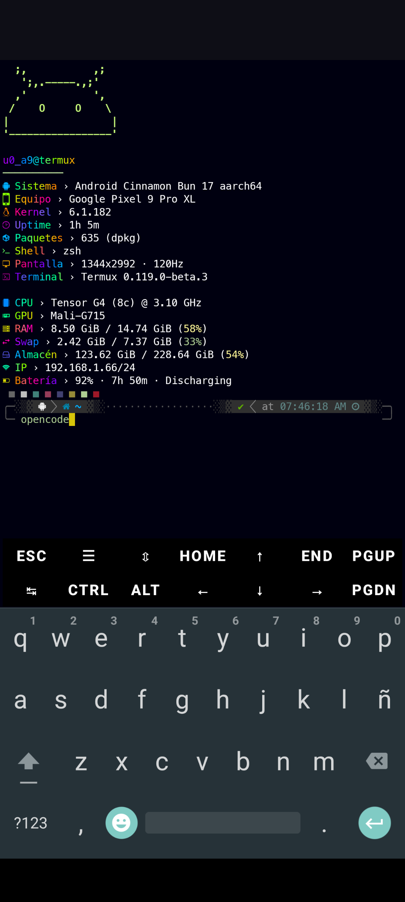
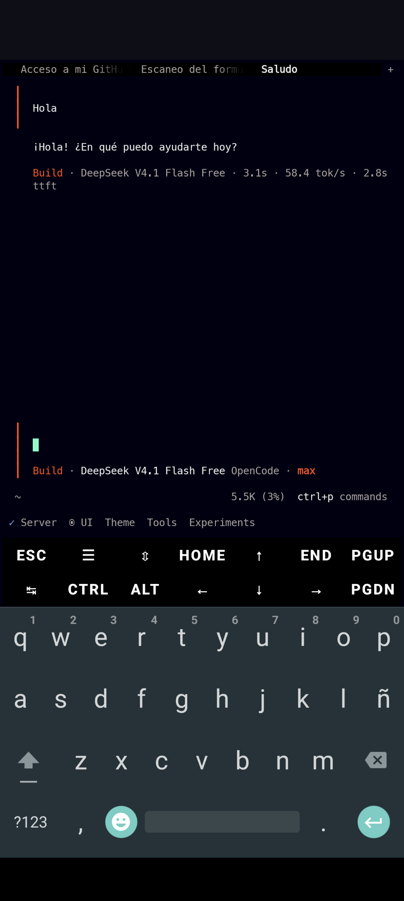

<!--
  Keep this document aligned with README.md, README.es.md, README.fr.md,
  install.sh, manager.sh, uninstall.sh, scripts/, release-checksums.json and .github/workflows/.
-->

<p align="center">
  
</p>

<h1 align="center">OpenCode for Termux</h1>

<p align="center">
  <strong>OpenCode AI coding agent running natively on Android with Termux.</strong><br>
  ARM64 runtime packaging · SHA-256 verification · managed installation
</p>

<p align="center">
  <a href="./README.md">Español</a> · <a href="./README.en.md">English</a> · <a href="./README.fr.md">Français</a>
</p>

<p align="center">
  <a href="https://github.com/C04-wq/opencode-termux/releases/latest"></a>
  <a href="https://github.com/C04-wq/opencode-termux/actions/workflows/validate.yml"></a>
  <a href="./LICENSE"></a>
</p>

<p align="center">
  <a href="#-about-the-project">About</a> ·
  <a href="#-requirements">Requirements</a> ·
  <a href="#-installation">Installation</a> ·
  <a href="#-updates">Updates</a> ·
  <a href="#-management-cli">Management CLI</a> ·
  <a href="#-technical-overview">Technical overview</a> ·
  <a href="#-troubleshooting">Troubleshooting</a>
</p>

---

## 📱 About the project

OpenCode is an open-source AI coding agent for the terminal. This repository packages it for Android Termux using Termux's native Bionic environment and Bun.

The runtime is a JavaScript bundle executed by Termux Bun, with Android-native libraries for the terminal UI, PTY and file watching. It does not execute the upstream Linux/musl ELF binary and does not require PRoot, a Linux VM, Node.js or npm on the device.

> [!IMPORTANT]
> This is an unofficial, community-maintained Termux adaptation. OpenCode itself is developed by anomalyco/opencode. This repository maintains the Termux installer, integration, update manager and validation.

### Highlights

- Native Android/Bionic runtime for ARM64 Termux (Android 9 / API 28 or newer).
- Bun-based JavaScript bundle with Bionic OpenTUI, PTY and file-watcher modules.
- SHA-256-pinned release asset, validated before extraction.
- Automatic installation of missing Termux dependencies: bun, ripgrep and libc++.
- Interactive update prompt with Install update now and Wait for the next version.
- opencode-termux management CLI and transactional runtime replacement with rollback.

## 📸 Screenshots

<p align="center">
  
  
</p>
<p align="center">
  
  
</p>

## ⚙️ Requirements

| Requirement | Details |
| --- | --- |
| Device | Android 9 (API 28) or newer running Termux |
| Architecture | ARM64 / aarch64 only |
| Runtime dependencies | Termux packages bun, ripgrep and libc++ (installed automatically if missing) |
| Installer tools | Bash, Git, curl, tar, sed and sha256sum |
| Termux support files | CA certificate bundle and resolver configuration |
| Network | Internet access for installation, pinned release downloads, update checks and AI providers |

The one-line installer requires curl to be installed already. It uses Termux pkg to install missing dependencies and support packages.

### Unsupported environments

32-bit ARM, x86/x86_64 Android, non-Termux Android shells, desktop Linux, macOS and Windows are not supported.

## 🚀 Installation

1. Install and open Termux from a trusted source.
2. Open the Termux terminal.
3. Run:

```bash
curl -fsSL https://raw.githubusercontent.com/C04-wq/opencode-termux/main/install.sh | bash
```

4. When the installer finishes, launch OpenCode:

```bash
opencode
```

Check the installed version or available OpenCode options:

```bash
opencode --version
opencode --help
```

### What happens during installation?

The installer performs the following operations:

1. **Checks the platform.** It requires `uname -m` to report `aarch64`.
2. **Prepares the project checkout.** For a piped installation, it uses `$PREFIX/opt/opencode-termux`. If it finds an existing clean clone of this repository in a common location under the Termux home directory, it updates that clone and moves it to the managed location where possible.
3. **Protects local work.** A discovered checkout with modified or untracked files is not overwritten; the installer stops and tells you to commit or stash the changes.
4. **Prepares dependencies.** It installs missing Git, curl, tar, coreutils, CA certificates and resolver support through `pkg`.
5. **Reads the release metadata.** The expected OpenCode version and archive SHA-256 digest come from `release-checksums.json` in the checked-out repository.
6. **Downloads the release.** It retrieves `opencode-termux-aarch64.tar.gz` from this repository's GitHub Release over HTTPS.
7. **Verifies the download.** It calculates SHA-256 and refuses to continue if the digest does not match the pinned metadata.
8. **Validates the archive layout.** It rejects unexpected files, duplicate entries, path traversal, unsafe links and incorrect file types before extraction.
9. **Stages the native bundle.** It prepares the Bun launcher, JavaScript module graph and Android libraries in a temporary location.
10. **Activates and tests.** It installs the native bundle and project launchers, then checks the version through Termux Bun.
11. **Protects the previous installation.** The old runtime and launchers are retained during activation and restored when the final activation/test path fails.

Successful setup commands are kept quiet to make the output readable. If a command fails, its captured output is printed to help diagnose the problem.

### Existing installations and conflict handling

The installer is deliberately conservative: it does not delete a command or package just because its name contains “OpenCode”.

It can replace recognized installations when ownership can be established:

- The legacy global npm package `opencode-termux` is removed only when its package metadata is valid and the existing `opencode` symlink resolves inside that package.
- A short allowlist of Termux/dpkg package owners is recognized through package ownership metadata: `opencode`, `opencode1`, `opencode-termux`, `opencode-wrapper` and `opencode1-wrapper`.
- A previous project-managed `opencode`, `opencode-termux-update` or `opencode-termux` launcher is replaced after its contents are recognized.

If an existing command is unknown, manually copied, or cannot be safely attributed to one of those installations, the installer stops and leaves it untouched. Identify and remove that installation yourself only after confirming its origin. It does not perform a broad cleanup of every similarly named file (for example, arbitrary `opencode2` binaries), unrelated npm packages, or unrelated directories.

The installer also does not remove OpenCode settings, sessions, projects or provider credentials.

### Installation locations

The default managed layout is:

| Component | Path |
| --- | --- |
| Project checkout | `$PREFIX/opt/opencode-termux` |
| OpenCode runtime and libraries | `$PREFIX/lib/opencode-termux/` |
| OpenCode command | `$PREFIX/bin/opencode` |
| Management CLI | `$PREFIX/bin/opencode-termux` |
| Internal updater | `$PREFIX/bin/opencode-termux-update` |
| Installed version marker | `$PREFIX/lib/opencode-termux/.opencode-termux-version` |
| Checkout path marker | `$PREFIX/lib/opencode-termux/.opencode-termux-repo-dir` |

In Termux, `$PREFIX` normally resolves to `/data/data/com.termux/files/usr`. The installer sets executable permissions on all three installed commands and checks that they are executable before reporting success.

Keep the managed checkout in place: the update command uses it to retrieve repository changes and rerun the installer.

## 🔄 Updates

There are two related but different update paths. Understanding the difference is important.

### 1. Interactive OpenCode update prompt

When you run `opencode` in an interactive terminal, the launcher checks the repository's `main` branch release metadata for a newer OpenCode runtime version.

If a newer version is available, it displays a menu:

```text
A new OpenCode version is available: 2.x.x (installed: 2.x.x).

Use ↑/↓ to choose and Enter to confirm.

● Install update now
  Wait for the next version
```

- **Install update now:** runs this project's updater, which fast-forwards the managed Git checkout and reruns the installer to download and verify the new runtime.
- **Wait for the next version:** starts the currently installed OpenCode version without updating.
- **Network unavailable:** the check is best-effort; a failed GitHub request does not prevent the installed OpenCode runtime from starting.
- **Non-interactive execution:** the menu is not shown when standard input/output are not terminals.

The prompt compares the installed OpenCode version with the version in `release-checksums.json`. It is a **runtime-version prompt**, not a general notification that every repository file or management script has changed. A manager-only or installer-only change may therefore require a manual project update even when OpenCode itself has not received a new version.

### 2. Update the project and runtime manually

To retrieve the latest project code and reinstall the verified runtime, run:

```bash
opencode-termux update
```

This command uses a fast-forward-only Git pull (`git pull --ff-only`) in the managed checkout and then executes its `install.sh`. It updates the manager, launcher, updater and runtime according to the checked-out repository and its release metadata.

The updater sets the checkout's local Git `core.filemode=false` setting. This avoids treating permission-bit-only differences as source changes on Termux while still allowing Git to detect content modifications.

If local edits or untracked files prevent a fast-forward update, the operation stops rather than overwriting those files. Inspect the checkout before retrying:

```bash
git -C "$PREFIX/opt/opencode-termux" status --short
```

Commit, stash or otherwise resolve your local changes before updating.

### 3. Re-run the installer to repair the installation

You can also rerun the one-line installer:

```bash
curl -fsSL https://raw.githubusercontent.com/C04-wq/opencode-termux/main/install.sh | bash
```

It detects the managed checkout and uses the installation procedure again. This is useful for repairing missing launchers or executable permissions as well as installing the version pinned by the checkout's release metadata.

> **Important:** OpenCode's own self-updater is disabled by the launcher with `OPENCODE_DISABLE_AUTOUPDATE=1`. This prevents upstream self-update from replacing the Termux-managed runtime outside the project's verified installation flow.

## 🧰 Management CLI

The installer provides a separate `opencode-termux` command. It manages this Termux package; it is not the OpenCode application itself.

Show the help:

```bash
opencode-termux
# or
opencode-termux --help
```

### Commands

| Command | Option form | Description |
| --- | --- | --- |
| `install` | `--install` | Install or repair the managed runtime using the existing checkout. |
| `update` | `--update` | Fast-forward the checkout and reinstall the verified runtime. |
| `uninstall` | `--uninstall` | Run the project's confirmation-based uninstaller. |
| `version` | `--version`, `-V` | Show the manager version and installed OpenCode version, if present. |
| `status` | `--status` | Show whether the runtime is installed and print its key paths. |
| `doctor` | `--doctor` | Check the architecture, dependencies, runtime files, launchers, permissions, certificates, resolver and runtime startup. |
| `help` | `--help`, `-h` | Show command help. |

Examples:

```bash
opencode-termux status
opencode-termux version
opencode-termux doctor
opencode-termux update
```

### Diagnostics with `doctor`

Run:

```bash
opencode-termux doctor
```

The diagnostic checks:

- The device architecture is `aarch64`.
- Required commands (`git`, `curl`, `tar`, `sha256sum`, `bun` and `rg`) are available.
- The Termux libc++ shared library is installed.
- The native launcher, JavaScript entry point, PTY library and watcher module exist.
- The native launcher has executable permissions.
- The installed version marker exists and has a valid version format.
- The OpenCode launcher is recognizable as the project-managed launcher.
- The manager command exists, is executable and contains the project ownership marker.
- The internal updater exists and is recognizable.
- The Termux CA bundle and resolver configuration are present.
- The installed OpenCode executable starts and reports the version recorded in its marker.

It prints individual `OK` / `FAIL` results and returns a non-zero exit status if a check fails. It is a local installation diagnostic; it does not validate API keys, provider accounts, internet access to every AI service or the health of upstream OpenCode.

## 🧩 Technical overview

### Runtime architecture

The installed runtime is stored in $PREFIX/lib/opencode-termux/lib/opencode and launched through $PREFIX/lib/opencode-termux/bin/opencode. The launcher executes Termux Bun. The bundle includes Bionic Android modules for OpenTUI, Rust PTY and @parcel/watcher.

This replaces the former Linux/musl approach: the installer no longer patches or executes a Linux ELF binary. Android shared libraries must be AArch64 ELF shared objects (ET_DYN) without glibc dependencies.

### Pinned runtime source

This repository's pipeline builds OpenCode from a pinned commit of the official source (anomalyco/opencode). GitHub Actions compiles the Bionic OpenTUI and PTY libraries, prepares the JavaScript bundle, inspects the ELF modules, and verifies the archive and its SHA-256 digest. tools/supply-chain-lock.json records source and tool revisions. The installer downloads the release selected by release-checksums.json; that metadata will remain pinned to the previously verified runtime until the new build passes a physical Termux ARM64 device test.

The bundle contains a shell launcher, the JavaScript module graph, a Bionic OpenTUI renderer, an Android PTY library and an Android file-watcher module.

### Installation and rollback

1. Check ARM64 and Android API compatibility.
2. Install missing bun, ripgrep and libc++ packages through Termux pkg.
3. Download the pinned Android bundle over HTTPS and verify SHA-256.
4. Validate archive paths and member types before extraction; reject traversal, links and special files.
5. Replace the build-time prefix placeholder with the managed runtime path.
6. Stage the bundle and preserve the previous runtime and launchers until activation.
7. Run the installed launcher's --version check and roll back if it fails.

Choosing **Wait for the next version** records the exact pending runtime/version target, so the same prompt is not repeated on every launch; a newer release still triggers a new prompt.

The launcher also compares a pinned runtime-generation marker, not just the OpenCode version. This makes existing 2.3.2 musl installations receive the migration prompt even though the OpenCode version number remains 2.3.2.

The project manager, updater, interactive update prompt and uninstaller remain separate from the upstream runtime bundle.

## 🔐 Security and integrity

- Downloads use HTTPS and are checked against the SHA-256 digest committed in this repository.
- The source repository and release tag are allowlisted and must match the pinned version.
- Archive paths and member types are checked before extraction; symbolic links, hardlinks, traversal and special files are rejected.
- CI checks native modules for AArch64 ELF shared-object format and absence of glibc dependencies.
- The installer does not overwrite unrecognized Termux commands.
- Runtime and launcher activation is transactional, with rollback if the final version check fails.
- The uninstaller verifies project ownership before removing managed files.

Trust boundary: source revisions and build tools are pinned and every artifact is verified, but SHA-256 is not an independent signature and does not replace auditing the code and build chain. Some Android compatibility scripts are derived from MIT-licensed work in Spectra010s/opencode-termux and are maintained and run by our own workflows; attribution and license notices are in THIRD_PARTY_NOTICES.md.

## 🤖 Release automation and CI

The validation workflow checks shell syntax, ShellCheck, manager consistency, archive safety, metadata and the pinned native bundle. It downloads the exact version and tag recorded in release-checksums.json, verifies SHA-256, inspects Android ELF shared libraries and exercises the launcher with a controlled Bun test double.

Hosted CI is not a physical-device test. A release must also be exercised on real Termux ARM64 devices, including interactive TUI use, PTY commands, file watching and background server startup, before it can be considered fully verified.

To test a PR candidate, download its `android-arm64-candidate-*` GitHub Actions artifact and run `bash scripts/test-termux-device.sh /path/to/opencode-VERSION-android-aarch64-bundle.tar.gz` on a physical ARM64 Termux device. The script installs the candidate into a separate directory under `$PREFIX/opt` and does not replace the current installation. Then launch the candidate and verify interactive TUI, PTY, file watching and the background server; remove the candidate directory when finished.

Installer metadata is changed only after a release has passed the source build, ELF, archive and SHA-256 checks. This project no longer builds or publishes the incompatible Linux/musl executable.
## 🛠️ Troubleshooting

### `opencode: command not found`

Check whether the managed launcher exists and rerun the installer:

```bash
ls -l "$PREFIX/bin/opencode"
bash "$PREFIX/opt/opencode-termux/install.sh"
hash -r
opencode --version
```

You can also rerun the one-line curl installer. It detects and reuses the managed checkout.

### `opencode-termux: command not found`

The management CLI is installed at `$PREFIX/bin/opencode-termux`. Check that it exists and that Termux's `bin` directory is in your `PATH`:

```bash
printf '%s\n' "$PATH"
ls -l "$PREFIX/bin/opencode-termux"
```

Then rerun the installer to restore the manager and enforce executable permissions:

```bash
bash "$PREFIX/opt/opencode-termux/install.sh"
hash -r
opencode-termux --help
```

### `permission denied`

The installer sets mode `755` on the OpenCode launcher, manager and updater after placing them in their final paths. Rerun the installer to repair these permissions:

```bash
bash "$PREFIX/opt/opencode-termux/install.sh"
ls -l "$PREFIX/bin/opencode" "$PREFIX/bin/opencode-termux" "$PREFIX/bin/opencode-termux-update"
```

### Unsupported architecture

Check the architecture reported by Termux:

```bash
uname -m
dpkg --print-architecture
```

The supported device must report `aarch64`. This package cannot run on 32-bit ARM or x86 devices.

### Download, TLS or DNS errors

Update Termux packages and check that GitHub is reachable:

```bash
pkg update
pkg install git curl tar coreutils ca-certificates resolv-conf
curl -I https://github.com
```

The installer checks for the Termux CA bundle and resolver configuration. Do not bypass SHA-256 verification when a download fails or a digest does not match.

### Update cannot fast-forward

The updater intentionally uses `git pull --ff-only`. Inspect the checkout:

```bash
git -C "$PREFIX/opt/opencode-termux" status --short
```

Commit, stash or otherwise resolve local changes before retrying `opencode-termux update`. The updater does not force-reset the checkout.

### The interactive update menu does not appear

The menu is displayed only when all of the following apply:

- OpenCode is started from an interactive terminal.
- The launcher can reach the repository's release metadata.
- The metadata contains a valid version newer than the installed runtime.

A repository-only change does not necessarily change the OpenCode runtime version. To retrieve manager or installer changes directly, use:

```bash
opencode-termux update
```

### OpenCode shell commands behave incorrectly

The launcher clears inherited `LD_PRELOAD` and configures the bundled runtime library path. First update the project:

```bash
opencode-termux update
opencode-termux doctor
```

If the issue persists, open an [issue](https://github.com/C04-wq/opencode-termux/issues) with your Android version, `uname -m`, OpenCode version, relevant command and complete error output. Remove API keys, tokens and other secrets from logs before sharing them.

## 🗑️ Uninstallation

To remove the managed Termux installation, run:

```bash
opencode-termux uninstall
```

The uninstaller asks for confirmation. You can also invoke it directly from the checkout:

```bash
bash "$PREFIX/opt/opencode-termux/uninstall.sh"
```

After confirmation, it removes only:

- `$PREFIX/lib/opencode-termux` — the managed runtime and its markers.
- `$PREFIX/bin/opencode` — this project's launcher.
- `$PREFIX/bin/opencode-termux-update` — the internal updater.
- `$PREFIX/bin/opencode-termux` — the management CLI.

It verifies the runtime marker and launcher identities before deleting files. If ownership cannot be established, it stops and leaves the installation untouched.

**The uninstaller does not remove:**

- The project checkout at `$PREFIX/opt/opencode-termux`.
- Termux packages or npm itself.
- OpenCode settings, sessions, projects or provider credentials.
- Other binaries or installations that are not part of this managed runtime.

If you also want to remove the project source, delete the checkout yourself after uninstalling and confirming that it contains no work you need.

## 🤝 Contributing

Issues, bug reports and pull requests are welcome. Please keep changes aligned with the supported Termux ARM64 target and avoid weakening archive validation, checksum verification, ownership checks or rollback behavior.

### Local validation

From a checkout of the repository, run the relevant checks:

```bash
# Shell syntax
bash -n install.sh uninstall.sh manager.sh opencode-termux
bash -n scripts/validate-runtime-archive.sh scripts/smoke-test-runtime-archive.sh

# JavaScript syntax and tests
node --check scripts/test-native-runtime-contract.mjs
node scripts/test-native-runtime-contract.mjs

# Shell regression tests
bash scripts/test-package-owner.sh
bash scripts/test-runtime-archive.sh

# Static analysis (requires ShellCheck)
shellcheck -S error install.sh uninstall.sh manager.sh opencode-termux scripts/*.sh
```

The GitHub Actions workflow also downloads the pinned Android bundle, verifies its checksum, inspects its ELF modules and exercises the launcher contract.

### Contribution guidelines

- Keep the repository's manager entry point (`opencode-termux`) synchronized with `manager.sh`.
- Keep the release archive layout and checksum metadata consistent with the installer and validator.
- Do not introduce unverified downloads or bypass upstream/project checksum checks.
- Preserve the Bionic runtime layout, pinned dependency hashes, PTY and background-server behavior.
- Document user-visible behavior changes in this README.
- Never include API keys, access tokens, personal credentials or private user data in commits or issue reports.

## 📄 License and acknowledgements

This repository is distributed under the [MIT License](./LICENSE).

[OpenCode](https://github.com/anomalyco/opencode) is a separate upstream project maintained by [anomalyco](https://github.com/anomalyco). This repository does not claim ownership of the upstream application. Refer to the upstream repository for its source code, licensing, releases and project notices.
