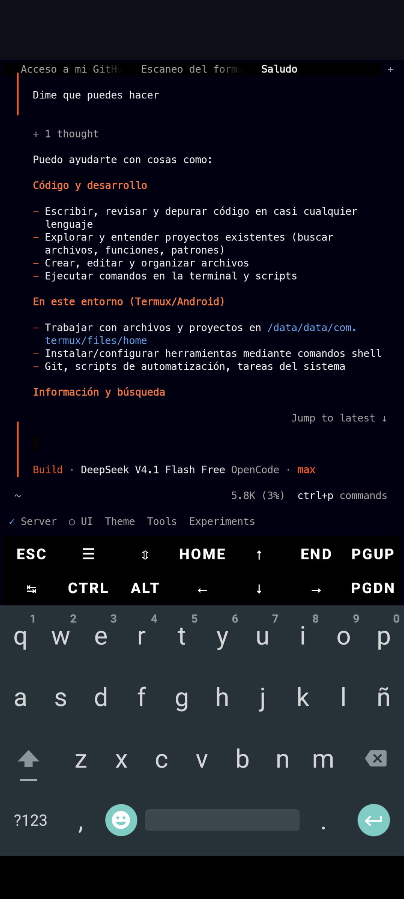

<!--
  Keep this document aligned with README.md, README.es.md, README.fr.md,
  install.sh, manager.sh, uninstall.sh, scripts/, release-checksums.json and .github/workflows/.
-->

<p align="center">
  
</p>

<h1 align="center">OpenCode for Termux</h1>

<p align="center">
  <strong>OpenCode AI coding agent running natively on Android with Termux.</strong><br>
  ARM64 runtime packaging · SHA-256 verification · managed installation · consent-based updates
</p>

<p align="center">
  <a href="./README.md">Español</a> · <a href="./README.en.md">English</a> · <a href="./README.fr.md">Français</a>
</p>

<p align="center">
  <a href="https://github.com/C04-wq/opencode-termux/releases/latest"></a>
  <a href="https://github.com/C04-wq/opencode-termux/actions/workflows/validate.yml"></a>
  <a href="https://github.com/C04-wq/opencode-termux/actions/workflows/release.yml"></a>
  <a href="./LICENSE"></a>
</p>

<p align="center">
  <a href="#-about-the-project">About</a> ·
  <a href="#-requirements">Requirements</a> ·
  <a href="#-installation">Installation</a> ·
  <a href="#-updates">Updates</a> ·
  <a href="#-management-cli">Management CLI</a> ·
  <a href="#-technical-overview">Technical overview</a> ·
  <a href="#-troubleshooting">Troubleshooting</a>
</p>

---

## 📱 About the project

[OpenCode](https://opencode.ai/) is an open-source AI coding agent that works in the terminal. This repository packages the official **Linux ARM64 musl** OpenCode release and adapts its runtime so it can execute directly in **Android [Termux](https://termux.dev/)**.

Android is not a conventional Linux distribution: its C library, filesystem layout, certificates and DNS configuration differ from the environment expected by a standard Linux binary. This project bridges those differences with a bundled musl runtime, a Termux-aware resolver path, a launcher and an installation/update manager.

The result is a direct Termux installation. It does not require a proot container, virtual machine, desktop Linux distribution, Node.js or npm on the device.

> [!IMPORTANT]
> This is an **unofficial, community-maintained Termux adaptation**. OpenCode itself is developed upstream by [anomalyco/opencode](https://github.com/anomalyco/opencode). This repository is responsible for the Android/Termux packaging, runtime integration and installer—not for the upstream OpenCode application or its AI providers.

### Highlights

- **Native Termux execution:** runs directly in the Termux environment; no proot or Linux VM.
- **ARM64 support:** targets Android devices whose Termux environment reports `aarch64`.
- **Cross-major release discovery:** selects the newest stable upstream OpenCode version across major versions (for example, 1.x to 2.x).
- **Verified package:** validates the downloaded archive against the SHA-256 digest recorded in this repository before extraction.
- **Bundled musl runtime:** includes the loader and required runtime libraries; no `patchelf`, Node.js or npm is needed on the phone.
- **Termux networking integration:** uses Termux's resolver configuration and CA certificate bundle.
- **Interactive, consent-based updates:** checks for a newer OpenCode runtime on interactive launches and asks before installing it.
- **Management command:** install, update, uninstall, inspect and diagnose this project's managed installation.
- **Defensive installation:** validates the package, stages files before activation, keeps the previous runtime during replacement and attempts rollback if activation or the final runtime check fails.
- **User-data preservation:** the uninstaller removes only the managed runtime and its launchers.

## 📸 Screenshots

<p align="center">
  
  
</p>
<p align="center">
  
  
</p>

## ⚙️ Requirements

| Requirement | Details |
| --- | --- |
| Device | Android device running Termux |
| Architecture | **ARM64 / `aarch64` only** |
| Network | Internet access for installation, GitHub release downloads, update checks and AI provider access |
| Initial command | `curl` must be available to run the one-line installer |
| Installer/runtime tools | Bash, Git, curl, tar and `sha256sum` (from `coreutils`) |
| Termux support files | CA certificate bundle and resolver configuration |

The installer uses Termux's `pkg` package manager to install missing tools and support packages, including Git, `ca-certificates` and `resolv-conf`, when needed. The one-line command itself requires `curl` to be installed already.

### Unsupported environments

This package currently does **not** support:

- 32-bit ARM (`arm` / `armv7`)
- x86 or x86_64 Android devices
- Non-Termux Android shells or other Android terminal environments
- Desktop Linux, macOS or Windows

The build and release automation target the Termux ARM64 environment specifically.

## 🚀 Installation

1. Install and open Termux from a trusted source.
2. Open the Termux terminal.
3. Run:

```bash
curl -fsSL https://raw.githubusercontent.com/C04-wq/opencode-termux/main/install.sh | bash
```

4. When the installer finishes, launch OpenCode:

```bash
opencode
```

Check the installed version or available OpenCode options:

```bash
opencode --version
opencode --help
```

### What happens during installation?

The installer performs the following operations:

1. **Checks the platform.** It requires `uname -m` to report `aarch64`.
2. **Prepares the project checkout.** For a piped installation, it uses `$PREFIX/opt/opencode-termux`. If it finds an existing clean clone of this repository in a common location under the Termux home directory, it updates that clone and moves it to the managed location where possible.
3. **Protects local work.** A discovered checkout with modified or untracked files is not overwritten; the installer stops and tells you to commit or stash the changes.
4. **Prepares dependencies.** It installs missing Git, curl, tar, coreutils, CA certificates and resolver support through `pkg`.
5. **Reads the release metadata.** The expected OpenCode version and archive SHA-256 digest come from `release-checksums.json` in the checked-out repository.
6. **Downloads the release.** It retrieves `opencode-termux-aarch64.tar.gz` from this repository's GitHub Release over HTTPS.
7. **Verifies the download.** It calculates SHA-256 and refuses to continue if the digest does not match the pinned metadata.
8. **Validates the archive layout.** It rejects unexpected files, duplicate entries, path traversal, unsafe links and incorrect file types before extraction.
9. **Stages the runtime.** It prepares the executable, musl loader and runtime libraries in a temporary location.
10. **Activates and tests.** It replaces the managed runtime, installs the launchers and checks that the installed binary reports the expected version.
11. **Protects the previous installation.** The old runtime and launchers are retained during activation and restored when the final activation/test path fails.

Successful setup commands are kept quiet to make the output readable. If a command fails, its captured output is printed to help diagnose the problem.

### Existing installations and conflict handling

The installer is deliberately conservative: it does not delete a command or package just because its name contains “OpenCode”.

It can replace recognized installations when ownership can be established:

- The legacy global npm package `opencode-termux` is removed only when its package metadata is valid and the existing `opencode` symlink resolves inside that package.
- A short allowlist of Termux/dpkg package owners is recognized through package ownership metadata: `opencode`, `opencode1`, `opencode-termux`, `opencode-wrapper` and `opencode1-wrapper`.
- A previous project-managed `opencode`, `opencode-termux-update` or `opencode-termux` launcher is replaced after its contents are recognized.

If an existing command is unknown, manually copied, or cannot be safely attributed to one of those installations, the installer stops and leaves it untouched. Identify and remove that installation yourself only after confirming its origin. It does not perform a broad cleanup of every similarly named file (for example, arbitrary `opencode2` binaries), unrelated npm packages, or unrelated directories.

The installer also does not remove OpenCode settings, sessions, projects or provider credentials.

### Installation locations

The default managed layout is:

| Component | Path |
| --- | --- |
| Project checkout | `$PREFIX/opt/opencode-termux` |
| OpenCode runtime and libraries | `$PREFIX/lib/opencode-termux/` |
| OpenCode command | `$PREFIX/bin/opencode` |
| Management CLI | `$PREFIX/bin/opencode-termux` |
| Internal updater | `$PREFIX/bin/opencode-termux-update` |
| Installed version marker | `$PREFIX/lib/opencode-termux/.opencode-termux-version` |
| Checkout path marker | `$PREFIX/lib/opencode-termux/.opencode-termux-repo-dir` |

In Termux, `$PREFIX` normally resolves to `/data/data/com.termux/files/usr`. The installer sets executable permissions on all three installed commands and checks that they are executable before reporting success.

Keep the managed checkout in place: the update command uses it to retrieve repository changes and rerun the installer.

## 🔄 Updates

There are two related but different update paths. Understanding the difference is important.

### 1. Interactive OpenCode update prompt

When you run `opencode` in an interactive terminal, the launcher checks the repository's `main` branch release metadata for a newer OpenCode runtime version.

If a newer version is available, it displays a menu:

```text
A new OpenCode version is available: 2.x.x (installed: 2.x.x).

Use ↑/↓ to choose and Enter to confirm.

● Install update now
  Wait for the next version
```

- **Install update now:** runs this project's updater, which fast-forwards the managed Git checkout and reruns the installer to download and verify the new runtime.
- **Wait for the next version:** starts the currently installed OpenCode version without updating.
- **Network unavailable:** the check is best-effort; a failed GitHub request does not prevent the installed OpenCode runtime from starting.
- **Non-interactive execution:** the menu is not shown when standard input/output are not terminals.

The prompt compares the installed OpenCode version with the version in `release-checksums.json`. It is a **runtime-version prompt**, not a general notification that every repository file or management script has changed. A manager-only or installer-only change may therefore require a manual project update even when OpenCode itself has not received a new version.

### 2. Update the project and runtime manually

To retrieve the latest project code and reinstall the verified runtime, run:

```bash
opencode-termux update
```

This command uses a fast-forward-only Git pull (`git pull --ff-only`) in the managed checkout and then executes its `install.sh`. It updates the manager, launcher, updater and runtime according to the checked-out repository and its release metadata.

The updater sets the checkout's local Git `core.filemode=false` setting. This avoids treating permission-bit-only differences as source changes on Termux while still allowing Git to detect content modifications.

If local edits or untracked files prevent a fast-forward update, the operation stops rather than overwriting those files. Inspect the checkout before retrying:

```bash
git -C "$PREFIX/opt/opencode-termux" status --short
```

Commit, stash or otherwise resolve your local changes before updating.

### 3. Re-run the installer to repair the installation

You can also rerun the one-line installer:

```bash
curl -fsSL https://raw.githubusercontent.com/C04-wq/opencode-termux/main/install.sh | bash
```

It detects the managed checkout and uses the installation procedure again. This is useful for repairing missing launchers or executable permissions as well as installing the version pinned by the checkout's release metadata.

> **Important:** OpenCode's own self-updater is disabled by the launcher with `OPENCODE_DISABLE_AUTOUPDATE=1`. This prevents upstream self-update from replacing the Termux-managed runtime outside the project's verified installation flow.

## 🧰 Management CLI

The installer provides a separate `opencode-termux` command. It manages this Termux package; it is not the OpenCode application itself.

Show the help:

```bash
opencode-termux
# or
opencode-termux --help
```

### Commands

| Command | Option form | Description |
| --- | --- | --- |
| `install` | `--install` | Install or repair the managed runtime using the existing checkout. |
| `update` | `--update` | Fast-forward the checkout and reinstall the verified runtime. |
| `uninstall` | `--uninstall` | Run the project's confirmation-based uninstaller. |
| `version` | `--version`, `-V` | Show the manager version and installed OpenCode version, if present. |
| `status` | `--status` | Show whether the runtime is installed and print its key paths. |
| `doctor` | `--doctor` | Check the architecture, dependencies, runtime files, launchers, permissions, certificates, resolver and runtime startup. |
| `help` | `--help`, `-h` | Show command help. |

Examples:

```bash
opencode-termux status
opencode-termux version
opencode-termux doctor
opencode-termux update
```

### Diagnostics with `doctor`

Run:

```bash
opencode-termux doctor
```

The diagnostic checks:

- The device architecture is `aarch64`.
- Required commands (`git`, `curl`, `tar` and `sha256sum`) are available.
- All expected runtime files exist and are non-empty.
- The OpenCode executable and musl loader have executable permissions.
- The installed version marker exists and has a valid version format.
- The OpenCode launcher is recognizable as the project-managed launcher.
- The manager command exists, is executable and contains the project ownership marker.
- The internal updater exists and is recognizable.
- The Termux CA bundle and resolver configuration are present.
- The installed OpenCode executable starts and reports the version recorded in its marker.

It prints individual `OK` / `FAIL` results and returns a non-zero exit status if a check fails. It is a local installation diagnostic; it does not validate API keys, provider accounts, internet access to every AI service or the health of upstream OpenCode.

## 🧩 Technical overview

This project packages the upstream OpenCode executable with a small musl runtime adapted for Termux.

### Runtime construction

1. **Upstream binary:** downloads the official `opencode-linux-arm64-musl.tar.gz` asset from [OpenCode releases](https://github.com/anomalyco/opencode/releases).
2. **Upstream integrity:** the builder verifies the upstream asset against the SHA-256 digest supplied by the upstream GitHub release metadata.
3. **musl:** builds musl 1.2.6 for AArch64 with its resolver configuration path changed from the conventional `/etc/resolv.conf` to Termux's `/data/data/com.termux/files/usr/etc/resolv.conf`.
4. **Runtime libraries:** packages the musl loader, musl libc, `libgcc_s.so.1` and `libstdc++.so.6`.
5. **ELF interpreter:** patches the OpenCode ELF `PT_INTERP` to the absolute path of the bundled Termux musl loader.
6. **Direct execution:** the launcher executes the OpenCode ELF directly. This is intentional: OpenCode 2.x re-executes `/proc/self/exe` when starting its background server. Launching the loader as a wrapper would cause that path to refer to the loader rather than the OpenCode executable.
7. **Termux environment:** the launcher clears inherited `LD_PRELOAD`, sets `SSL_CERT_FILE` to the Termux CA bundle and adds the bundled runtime directory to `LD_LIBRARY_PATH`.
8. **Managed updates:** `OPENCODE_DISABLE_AUTOUPDATE=1` disables OpenCode's own updater so runtime replacement remains under this project's installer.

### Runtime archive contents

The release archive has a deliberately strict, flat layout:

| Entry | Purpose |
| --- | --- |
| `opencode` | Upstream OpenCode AArch64 executable, patched for the bundled interpreter |
| `ld-musl-aarch64.so.1` | musl dynamic loader |
| `libc.musl-aarch64.so.1` | musl C library |
| `libgcc_s.so.1` | GCC runtime support library |
| `libstdc++.so.6.runtime` | Bundled GNU C++ runtime library |
| `libstdc++.so.6` | Relative symlink to `libstdc++.so.6.runtime` |

The archive validator requires exactly these six entries. It rejects additional paths, duplicates, directories, hardlinks, unexpected symlinks, unsafe link targets and path traversal before extracting anything.

### Repository structure

```text
.
├── .github/
│   ├── dependabot.yml
│   └── workflows/
│       ├── validate.yml
│       ├── release.yml
│       └── toolchain-updates.yml
├── scripts/
│   ├── build-android-release.sh
│   ├── setup-alpine-chroot.sh
│   ├── resolve-opencode-release.mjs
│   ├── validate-runtime-archive.sh
│   ├── smoke-test-runtime-archive.sh
│   └── tests and toolchain helpers
├── screenshots/
├── install.sh
├── manager.sh
├── opencode-termux
├── uninstall.sh
├── release-checksums.json
├── opencode-logo.svg
├── README.md
├── README.en.md
├── README.es.md
└── README.fr.md
```

- `install.sh`: bootstrap, dependency preparation, verified runtime installation and launcher generation.
- `manager.sh` / `opencode-termux`: management CLI. The repository entry point and canonical manager implementation are kept in sync and checked by CI.
- `uninstall.sh`: confirmation-based removal of the managed runtime and launchers.
- `release-checksums.json`: current runtime version and expected archive digest.
- `scripts/build-android-release.sh`: builds the Termux ARM64 archive.
- `scripts/validate-runtime-archive.sh`: validates the archive structure before extraction.
- `scripts/smoke-test-runtime-archive.sh`: exercises the packaged AArch64 executable under QEMU.
- `scripts/resolve-opencode-release.mjs`: finds and validates the newest stable upstream OpenCode release.
- `scripts/setup-alpine-chroot.sh`: prepares the Alpine package-verification environment used by CI.

## 🔐 Security and integrity

The installation flow is designed to fail closed when package integrity or file ownership cannot be established.

- The runtime archive is downloaded over HTTPS, with curl restricted to HTTPS for the initial request and redirects.
- The runtime archive must match the SHA-256 digest in `release-checksums.json`.
- The release builder independently checks the official upstream archive digest before packaging it.
- The archive validator checks every member before extraction and allows only the expected relative C++ library symlink.
- The installer does not overwrite unrecognized commands in Termux's `bin` directory.
- Legacy npm cleanup is conditional on package metadata and symlink ownership; Termux package cleanup is conditional on dpkg ownership and an explicit allowlist.
- Installation stages the new runtime and preserves the previous runtime/launchers during activation, with rollback handling for failures.
- The uninstaller verifies the project's runtime marker and recognizable launchers before removing them.
- GitHub Actions use explicit workflow permissions, pinned third-party action commit SHAs, and avoid exposing write credentials to build/smoke-test steps.

**What this does not guarantee:** SHA-256 verification confirms that the downloaded archive matches the digest published by this repository; it is not a separate digital signature. The project also cannot guarantee the security or availability of upstream OpenCode, third-party AI providers, API services, or user-installed Termux packages. Review releases and source changes before installing if you need an independent audit.

## 🤖 Release automation and CI

GitHub Actions build releases and validate the installer/runtime.

| Workflow | Trigger | Purpose |
| --- | --- | --- |
| [Validate Termux installer](.github/workflows/validate.yml) | Pushes, pull requests and manual dispatch | Syntax checks, ShellCheck, YAML validation, release metadata checks, regression tests, archive safety tests and ARM64 runtime smoke tests under QEMU. |
| [Build and publish GitHub release](.github/workflows/release.yml) | Every 6 hours, relevant pushes to `main`, or manual dispatch | Resolves the newest stable upstream release, builds and tests the Termux archive, publishes release assets and updates checksum metadata. |
| [Check toolchain updates](.github/workflows/toolchain-updates.yml) | Daily schedule, relevant pushes/pull requests or manual dispatch | Checks Alpine stable branches, validates a candidate build and opens a reviewable pull request when the pinned build branch advances. |

### Release selection

The release resolver:

- Retrieves all pages of upstream GitHub releases.
- Compares stable semantic versions numerically across major versions.
- Excludes drafts, prereleases and tags that do not use the expected stable `vMAJOR.MINOR.PATCH` format.
- Requires the newest stable release to publish the official ARM64 musl archive and a valid SHA-256 digest.
- Fails instead of silently selecting an older version if the newest stable release is missing the required asset or digest.

Each project release publishes:

- `opencode-termux-aarch64.tar.gz` — the packaged runtime.
- `opencode-termux-aarch64.tar.gz.sha256` — the archive checksum.

The workflow updates `release-checksums.json` with the version and digest used by the installer.

### Validation coverage

CI includes:

- Bash syntax checks and ShellCheck.
- Node.js syntax and unit/regression tests for release and toolchain helpers.
- YAML parsing for workflows and Dependabot configuration.
- Checks that the manager entry point matches the canonical manager implementation.
- Tests for dpkg package-owner detection.
- Archive tests covering valid archives, unexpected files, traversal, unsafe symlinks, wrong symlink targets and hardlinks.
- An ARM64 QEMU smoke test that inspects the ELF architecture and interpreter, runs `opencode --version`, and verifies that `opencode serve` remains running until the test timeout.

> **Testing limitation:** QEMU provides useful automated ARM64 runtime coverage, but it is not a substitute for testing every release on a physical Android device with Termux. CI does not prove compatibility with every Android version, device, network, provider or user configuration.

Node.js is used by hosted GitHub Actions scripts only. It is not required on the Android device.

## 🛠️ Troubleshooting

### `opencode: command not found`

Check whether the managed launcher exists and rerun the installer:

```bash
ls -l "$PREFIX/bin/opencode"
bash "$PREFIX/opt/opencode-termux/install.sh"
hash -r
opencode --version
```

You can also rerun the one-line curl installer. It detects and reuses the managed checkout.

### `opencode-termux: command not found`

The management CLI is installed at `$PREFIX/bin/opencode-termux`. Check that it exists and that Termux's `bin` directory is in your `PATH`:

```bash
printf '%s\n' "$PATH"
ls -l "$PREFIX/bin/opencode-termux"
```

Then rerun the installer to restore the manager and enforce executable permissions:

```bash
bash "$PREFIX/opt/opencode-termux/install.sh"
hash -r
opencode-termux --help
```

### `permission denied`

The installer sets mode `755` on the OpenCode launcher, manager and updater after placing them in their final paths. Rerun the installer to repair these permissions:

```bash
bash "$PREFIX/opt/opencode-termux/install.sh"
ls -l "$PREFIX/bin/opencode" "$PREFIX/bin/opencode-termux" "$PREFIX/bin/opencode-termux-update"
```

### Unsupported architecture

Check the architecture reported by Termux:

```bash
uname -m
dpkg --print-architecture
```

The supported device must report `aarch64`. This package cannot run on 32-bit ARM or x86 devices.

### Download, TLS or DNS errors

Update Termux packages and check that GitHub is reachable:

```bash
pkg update
pkg install git curl tar coreutils ca-certificates resolv-conf
curl -I https://github.com
```

The installer checks for the Termux CA bundle and resolver configuration. Do not bypass SHA-256 verification when a download fails or a digest does not match.

### Update cannot fast-forward

The updater intentionally uses `git pull --ff-only`. Inspect the checkout:

```bash
git -C "$PREFIX/opt/opencode-termux" status --short
```

Commit, stash or otherwise resolve local changes before retrying `opencode-termux update`. The updater does not force-reset the checkout.

### The interactive update menu does not appear

The menu is displayed only when all of the following apply:

- OpenCode is started from an interactive terminal.
- The launcher can reach the repository's release metadata.
- The metadata contains a valid version newer than the installed runtime.

A repository-only change does not necessarily change the OpenCode runtime version. To retrieve manager or installer changes directly, use:

```bash
opencode-termux update
```

### OpenCode shell commands behave incorrectly

The launcher clears inherited `LD_PRELOAD` and configures the bundled runtime library path. First update the project:

```bash
opencode-termux update
opencode-termux doctor
```

If the issue persists, open an [issue](https://github.com/C04-wq/opencode-termux/issues) with your Android version, `uname -m`, OpenCode version, relevant command and complete error output. Remove API keys, tokens and other secrets from logs before sharing them.

## 🗑️ Uninstallation

To remove the managed Termux installation, run:

```bash
opencode-termux uninstall
```

The uninstaller asks for confirmation. You can also invoke it directly from the checkout:

```bash
bash "$PREFIX/opt/opencode-termux/uninstall.sh"
```

After confirmation, it removes only:

- `$PREFIX/lib/opencode-termux` — the managed runtime and its markers.
- `$PREFIX/bin/opencode` — this project's launcher.
- `$PREFIX/bin/opencode-termux-update` — the internal updater.
- `$PREFIX/bin/opencode-termux` — the management CLI.

It verifies the runtime marker and launcher identities before deleting files. If ownership cannot be established, it stops and leaves the installation untouched.

**The uninstaller does not remove:**

- The project checkout at `$PREFIX/opt/opencode-termux`.
- Termux packages or npm itself.
- OpenCode settings, sessions, projects or provider credentials.
- Other binaries or installations that are not part of this managed runtime.

If you also want to remove the project source, delete the checkout yourself after uninstalling and confirming that it contains no work you need.

## 🤝 Contributing

Issues, bug reports and pull requests are welcome. Please keep changes aligned with the supported Termux ARM64 target and avoid weakening archive validation, checksum verification, ownership checks or rollback behavior.

### Local validation

From a checkout of the repository, run the relevant checks:

```bash
# Shell syntax
bash -n install.sh uninstall.sh manager.sh opencode-termux
bash -n scripts/build-android-release.sh scripts/setup-alpine-chroot.sh
bash -n scripts/validate-runtime-archive.sh scripts/smoke-test-runtime-archive.sh

# JavaScript syntax and tests
node --check scripts/resolve-opencode-release.mjs
node --check scripts/check-toolchain-updates.mjs
node scripts/test-opencode-release-resolver.mjs
node scripts/test-toolchain-updates.mjs

# Shell regression tests
bash scripts/test-package-owner.sh
bash scripts/test-runtime-archive.sh

# Static analysis (requires ShellCheck)
shellcheck -S error install.sh uninstall.sh manager.sh opencode-termux scripts/*.sh
```

The GitHub Actions validation workflow runs these checks plus YAML validation and the ARM64 QEMU smoke test.

### Contribution guidelines

- Keep the repository's manager entry point (`opencode-termux`) synchronized with `manager.sh`.
- Keep the release archive layout and checksum metadata consistent with the installer and validator.
- Do not introduce unverified downloads or bypass upstream/project checksum checks.
- Preserve the Termux resolver path, ELF interpreter configuration and direct execution behavior required by OpenCode's background server.
- Document user-visible behavior changes in this README.
- Never include API keys, access tokens, personal credentials or private user data in commits or issue reports.

## 📄 License and acknowledgements

This repository is distributed under the [MIT License](./LICENSE).

[OpenCode](https://github.com/anomalyco/opencode) is a separate upstream project maintained by [anomalyco](https://github.com/anomalyco). This repository does not claim ownership of the upstream application. Refer to the upstream repository for its source code, licensing, releases and project notices.
