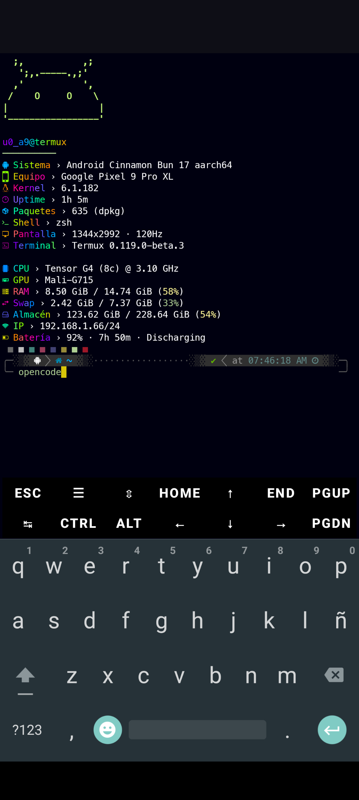
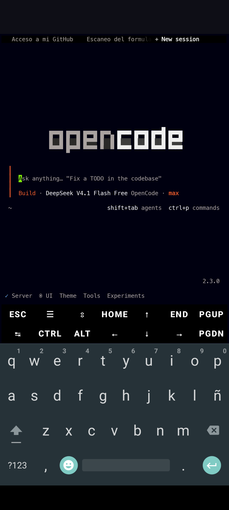
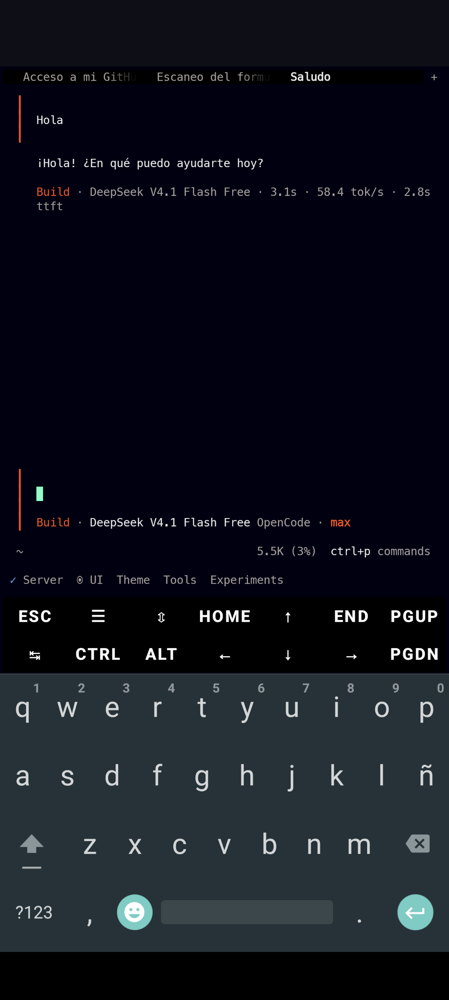
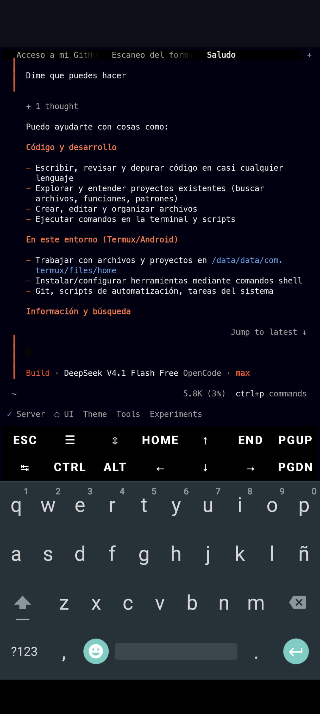

<!--
  Mantén este documento sincronizado con README.md, README.es.md, README.en.md, README.fr.md,
  install.sh, manager.sh, uninstall.sh, scripts/, release-checksums.json y .github/workflows/.
-->

<p align="center">
  
</p>

<h1 align="center">OpenCode para Termux</h1>

<p align="center">
  <strong>Agente de programación con IA OpenCode ejecutándose de forma nativa en Android mediante Termux.</strong><br>
  Empaquetado del entorno de ejecución ARM64 · Verificación SHA-256 · Instalación gestionada
</p>


<p align="center">
  <a href="./README.md">Español</a> · <a href="./README.en.md">English</a> · <a href="./README.fr.md">Français</a>
</p>

<p align="center">
  <a href="https://github.com/C04-wq/opencode-termux/releases/latest"></a>
  <a href="https://github.com/C04-wq/opencode-termux/actions/workflows/validate.yml"></a>
  <a href="https://github.com/C04-wq/opencode-termux/actions/workflows/release.yml"></a>
  <a href="./LICENSE"></a>
</p>

<p align="center">
  <a href="#-acerca-del-proyecto">Proyecto</a> ·
  <a href="#-requisitos">Requisitos</a> ·
  <a href="#-instalación">Instalación</a> ·
  <a href="#-actualizaciones">Actualizaciones</a> ·
  <a href="#-cli-de-administración">CLI de administración</a> ·
  <a href="#-descripción-técnica">Descripción técnica</a> ·
  <a href="#-solución-de-problemas">Solución de problemas</a>
</p>

---

## 📱 Acerca del proyecto

[OpenCode](https://opencode.ai/) es un agente de programación de código abierto que funciona en la terminal. Este repositorio empaqueta la versión oficial **Linux ARM64 musl** de OpenCode y adapta su entorno de ejecución para que pueda ejecutarse directamente en **Android [Termux](https://termux.dev/)**.

Android no es una distribución Linux convencional: su biblioteca C, la estructura del sistema de archivos, los certificados y la configuración DNS difieren del entorno esperado por un binario Linux estándar. Este proyecto resuelve esas diferencias mediante un entorno musl incluido, una ruta de resolución DNS adaptada a Termux, un lanzador y un gestor de instalación y actualización.

El resultado es una instalación directa en Termux. No requiere contenedor proot, máquina virtual, distribución Linux de escritorio, Node.js ni npm en el dispositivo.

> [!IMPORTANT]
> Esta es una **adaptación comunitaria no oficial para Termux**. OpenCode es desarrollado por el proyecto original [anomalyco/opencode](https://github.com/anomalyco/opencode). Este repositorio se encarga del empaquetado para Android/Termux, la integración del entorno de ejecución y el instalador; no desarrolla la aplicación OpenCode original ni sus proveedores de IA.

### Características principales

- **Actualizaciones interactivas con consentimiento:** comprueba si existe una versión más reciente al iniciar OpenCode en una terminal interactiva y pregunta antes de instalarla.

- **Ejecución nativa en Termux:** funciona directamente en Termux, sin proot ni máquina virtual Linux.
- **Compatibilidad ARM64:** dispositivos Android cuyo entorno Termux informa `aarch64`.
- **Detección de versiones entre ramas principales:** selecciona la versión estable más reciente de OpenCode entre todas las versiones principales (por ejemplo, de 1.x a 2.x).
- **Paquete verificado:** comprueba el archivo descargado con el hash SHA-256 registrado en este repositorio antes de extraerlo.
- **Entorno musl incluido:** incorpora el cargador y las bibliotecas necesarias; no necesita `patchelf`, Node.js ni npm en el teléfono.
- **Integración de red con Termux:** utiliza la configuración DNS y el paquete de certificados CA de Termux.

- **Comando de administración:** permite instalar, actualizar, desinstalar, inspeccionar y diagnosticar la instalación gestionada.
- **Instalación defensiva:** valida el paquete, prepara los archivos antes de activarlos, conserva el entorno anterior durante el reemplazo e intenta restaurarlo si falla la activación o la comprobación final.
- **Protección de datos:** el desinstalador elimina únicamente el entorno gestionado y sus lanzadores.

## 📸 Capturas de pantalla

<p align="center">
  
  
</p>
<p align="center">
  
  
</p>

## ⚙️ Requisitos

| Requisito | Detalles |
| --- | --- |
| Dispositivo | Android con Termux |
| Arquitectura | **Solo ARM64 / `aarch64`** |
| Red | Internet para instalar, descargar releases de GitHub, comprobar actualizaciones y acceder a proveedores de IA |
| Comando inicial | `curl` debe estar disponible para ejecutar el instalador de una línea |
| Herramientas | Bash, Git, curl, tar y `sha256sum` (de `coreutils`) |
| Archivos de soporte | Paquete de certificados CA y configuración de resolución DNS de Termux |

Cuando es necesario, el instalador utiliza el gestor de paquetes `pkg` de Termux para instalar herramientas y paquetes de soporte, incluidos Git, `ca-certificates` y `resolv-conf`. El propio comando de instalación requiere que `curl` ya esté instalado.

### Entornos no compatibles

Actualmente este paquete **no es compatible** con:

- ARM de 32 bits (`arm` / `armv7`)
- Dispositivos Android x86 o x86_64
- Shells de Android que no sean Termux ni otros entornos de terminal Android
- Linux de escritorio, macOS o Windows

La compilación y la automatización de releases están diseñadas específicamente para Termux ARM64.

## 🚀 Instalación

1. Instala y abre Termux desde una fuente de confianza.
2. Abre la terminal de Termux.
3. Ejecuta:

```bash
curl -fsSL https://raw.githubusercontent.com/C04-wq/opencode-termux/main/install.sh | bash
```

4. Cuando termine el instalador, inicia OpenCode:

```bash
opencode
```

Comprueba la versión instalada o consulta las opciones:

```bash
opencode --version
opencode --help
```

### ¿Qué hace el instalador?

1. **Comprueba la plataforma.** Exige que `uname -m` devuelva `aarch64`.
2. **Prepara el repositorio del proyecto.** En una instalación canalizada utiliza `$PREFIX/opt/opencode-termux`. Si encuentra una copia limpia de este repositorio en una ubicación habitual dentro del directorio personal de Termux, la actualiza y, cuando es posible, la traslada a la ubicación gestionada.
3. **Protege los cambios locales.** Si la copia detectada contiene archivos modificados o sin seguimiento, no los sobrescribe: se detiene y solicita confirmar o guardar esos cambios.
4. **Prepara dependencias.** Instala mediante `pkg` Git, curl, tar, coreutils, certificados CA y soporte de resolución DNS cuando faltan.
5. **Lee los metadatos de la release.** La versión esperada de OpenCode y el hash SHA-256 del archivo proceden de `release-checksums.json`.
6. **Descarga la release.** Obtiene `opencode-termux-aarch64.tar.gz` desde las GitHub Releases de este repositorio mediante HTTPS.
7. **Verifica la descarga.** Calcula SHA-256 y se niega a continuar si el hash no coincide con los metadatos fijados.
8. **Valida el contenido del archivo.** Rechaza archivos inesperados, entradas duplicadas, traversal de rutas, enlaces inseguros y tipos de archivo incorrectos antes de extraer.
9. **Prepara el entorno.** Coloca el ejecutable, el cargador musl y las bibliotecas en una ubicación temporal.
10. **Activa y prueba.** Sustituye el entorno gestionado, instala los lanzadores y comprueba que el binario informa de la versión esperada.
11. **Protege la instalación anterior.** Conserva el entorno y los lanzadores previos durante la activación y trata de restaurarlos si falla la activación o la prueba final.

Los comandos que terminan correctamente se mantienen silenciosos para que la salida sea legible. Si alguno falla, se muestra su salida capturada para facilitar el diagnóstico.

### Instalaciones existentes y conflictos

El instalador es deliberadamente conservador: no elimina un comando o paquete solo porque su nombre contenga «OpenCode».

Puede reemplazar instalaciones reconocidas cuando puede establecer su propiedad:

- El paquete global npm heredado `opencode-termux` solo se elimina si sus metadatos son válidos y el enlace simbólico `opencode` existente apunta dentro de ese paquete.
- Se reconoce una lista limitada de propietarios de paquetes Termux/dpkg mediante sus metadatos: `opencode`, `opencode1`, `opencode-termux`, `opencode-wrapper` y `opencode1-wrapper`.
- Un lanzador anterior gestionado por este proyecto (`opencode`, `opencode-termux-update` u `opencode-termux`) se sustituye después de reconocer su contenido.

Si un comando existente es desconocido, se copió manualmente o no puede atribuirse con seguridad a una de esas instalaciones, el instalador se detiene y no lo modifica. Identifica y elimina esa instalación manualmente solo después de confirmar su origen. No realiza una limpieza indiscriminada de todos los archivos con nombres parecidos (por ejemplo, binarios arbitrarios `opencode2`), paquetes npm ajenos ni directorios no relacionados.

El instalador tampoco elimina la configuración, las sesiones, los proyectos ni las credenciales de proveedores de OpenCode.

### Rutas de instalación

| Componente | Ruta |
| --- | --- |
| Copia del repositorio | `$PREFIX/opt/opencode-termux` |
| Entorno OpenCode y bibliotecas | `$PREFIX/lib/opencode-termux/` |
| Comando OpenCode | `$PREFIX/bin/opencode` |
| CLI de administración | `$PREFIX/bin/opencode-termux` |
| Actualizador interno | `$PREFIX/bin/opencode-termux-update` |
| Marcador de versión instalada | `$PREFIX/lib/opencode-termux/.opencode-termux-version` |
| Marcador de ruta del repositorio | `$PREFIX/lib/opencode-termux/.opencode-termux-repo-dir` |

En Termux, `$PREFIX` normalmente corresponde a `/data/data/com.termux/files/usr`. El instalador asigna permisos de ejecución a los tres comandos instalados y comprueba que sean ejecutables antes de confirmar el éxito.

Conserva la copia gestionada del repositorio: el comando de actualización la utiliza para obtener cambios y volver a ejecutar el instalador.

## 🔄 Actualizaciones

Existen dos mecanismos de actualización relacionados, pero distintos.

### 1. Aviso interactivo de actualización de OpenCode

Al ejecutar `opencode` en una terminal interactiva, el lanzador comprueba los metadatos de releases de la rama `main` para detectar una versión más reciente del entorno OpenCode.

Si hay una versión nueva, muestra un menú:

```text
A new OpenCode version is available: 2.x.x (installed: 2.x.x).

Use ↑/↓ to choose and Enter to confirm.

● Install update now
  Wait for the next version
```

- **Install update now:** ejecuta el actualizador del proyecto, que adelanta la copia Git gestionada mediante fast-forward y vuelve a ejecutar el instalador para descargar y verificar el nuevo entorno.
- **Wait for the next version:** inicia la versión instalada sin actualizar.
- **Sin conexión:** la comprobación es opcional; si falla una petición a GitHub, el entorno instalado puede iniciarse igualmente.
- **Ejecución no interactiva:** el menú no aparece cuando la entrada o salida estándar no son terminales.

El aviso compara la versión instalada de OpenCode con la versión de `release-checksums.json`. Es un aviso de **versión del entorno de ejecución**, no una notificación general de cambios en todos los archivos del repositorio. Por tanto, un cambio exclusivo del gestor o del instalador puede requerir una actualización manual del proyecto aunque OpenCode no haya publicado una versión nueva.

### 2. Actualizar manualmente el proyecto y el entorno

Para obtener el código más reciente del proyecto y reinstalar el entorno verificado:

```bash
opencode-termux update
```

Este comando ejecuta una actualización Git solo mediante fast-forward (`git pull --ff-only`) en la copia gestionada y después ejecuta su `install.sh`. Actualiza el gestor, el lanzador, el actualizador y el entorno según el repositorio y sus metadatos de release.

El actualizador establece la opción local de Git `core.filemode=false`. Así evita que diferencias exclusivas de permisos se consideren cambios de código en Termux, sin dejar de detectar modificaciones en el contenido.

Si los cambios locales o los archivos sin seguimiento impiden el fast-forward, la operación se detiene en lugar de sobrescribirlos. Inspecciona la copia:

```bash
git -C "$PREFIX/opt/opencode-termux" status --short
```

Confirma, guarda temporalmente o resuelve los cambios antes de volver a actualizar.

### 3. Volver a ejecutar el instalador para reparar la instalación

También puedes ejecutar de nuevo el instalador:

```bash
curl -fsSL https://raw.githubusercontent.com/C04-wq/opencode-termux/main/install.sh | bash
```

Detecta la copia gestionada y repite el procedimiento de instalación. Sirve para reparar lanzadores o permisos de ejecución ausentes, además de instalar la versión indicada por los metadatos de release de la copia local.

> **Importante:** el lanzador desactiva el actualizador propio de OpenCode mediante `OPENCODE_DISABLE_AUTOUPDATE=1`. Así se evita que el actualizador upstream sustituya el entorno gestionado por Termux fuera del proceso verificado de este proyecto.

## 🧰 CLI de administración

El instalador proporciona el comando independiente `opencode-termux`. Administra este paquete para Termux; no es la aplicación OpenCode.

Consulta la ayuda:

```bash
opencode-termux
# o
opencode-termux --help
```

### Comandos

| Comando | Forma con opción | Descripción |
| --- | --- | --- |
| `install` | `--install` | Instala o repara el entorno gestionado usando la copia existente. |
| `update` | `--update` | Actualiza la copia mediante fast-forward y reinstala el entorno verificado. |
| `uninstall` | `--uninstall` | Ejecuta el desinstalador del proyecto, que solicita confirmación. |
| `version` | `--version`, `-V` | Muestra la versión del gestor y la versión de OpenCode instalada, si existe. |
| `status` | `--status` | Indica si el entorno está instalado y muestra sus rutas principales. |
| `doctor` | `--doctor` | Comprueba arquitectura, dependencias, archivos, lanzadores, permisos, certificados, DNS e inicio del entorno. |
| `help` | `--help`, `-h` | Muestra la ayuda. |

Ejemplos:

```bash
opencode-termux status
opencode-termux version
opencode-termux doctor
opencode-termux update
```

### Diagnóstico con `doctor`

Ejecuta:

```bash
opencode-termux doctor
```

El diagnóstico comprueba:

- Que la arquitectura del dispositivo sea `aarch64`.
- Que estén disponibles los comandos necesarios (`git`, `curl`, `tar` y `sha256sum`).
- Que existan todos los archivos esperados del entorno y no estén vacíos.
- Que el ejecutable OpenCode y el cargador musl tengan permisos de ejecución.
- Que exista el marcador de versión y tenga un formato válido.
- Que el lanzador OpenCode corresponda al gestionado por el proyecto.
- Que el comando de administración exista, sea ejecutable y contenga el marcador de propiedad del proyecto.
- Que exista el actualizador interno y sea reconocible.
- Que estén presentes el paquete de certificados CA y la configuración DNS de Termux.
- Que el ejecutable instalado arranque e informe de la versión registrada en su marcador.

Muestra resultados individuales `OK` / `FAIL` y devuelve un código de salida distinto de cero si falla alguna comprobación. Es un diagnóstico local de la instalación: no valida claves API, cuentas de proveedores, acceso a todos los servicios de IA ni el estado del proyecto upstream.

## 🧩 Descripción técnica

Este proyecto empaqueta el ejecutable upstream de OpenCode con un pequeño entorno musl adaptado a Termux.

### Construcción del entorno

1. **Binario upstream:** descarga el recurso oficial `opencode-linux-arm64-musl.tar.gz` desde las [releases de OpenCode](https://github.com/anomalyco/opencode/releases).
2. **Integridad upstream:** el constructor verifica el archivo oficial mediante el hash SHA-256 proporcionado por los metadatos de la release upstream.
3. **musl:** compila musl 1.2.6 para AArch64 con la ruta de configuración del resolver cambiada de `/etc/resolv.conf` a `/data/data/com.termux/files/usr/etc/resolv.conf`.
4. **Bibliotecas:** empaqueta el cargador musl, musl libc, `libgcc_s.so.1` y `libstdc++.so.6`.
5. **Intérprete ELF:** ajusta el `PT_INTERP` del ELF de OpenCode para apuntar a la ruta absoluta del cargador musl incluido.
6. **Ejecución directa:** el lanzador ejecuta directamente el ELF de OpenCode. Es intencionado: OpenCode 2.x vuelve a ejecutar `/proc/self/exe` al iniciar su servidor en segundo plano. Si se iniciara el cargador como envoltorio, esa ruta apuntaría al cargador y no al ejecutable OpenCode.
7. **Entorno Termux:** el lanzador limpia el `LD_PRELOAD` heredado, establece `SSL_CERT_FILE` al paquete CA de Termux y añade el directorio del entorno incluido a `LD_LIBRARY_PATH`.
8. **Actualizaciones gestionadas:** `OPENCODE_DISABLE_AUTOUPDATE=1` desactiva el actualizador propio de OpenCode para que el reemplazo del entorno siga bajo control del instalador del proyecto.

### Contenido del archivo de runtime

La release contiene una estructura plana y estricta:

| Entrada | Función |
| --- | --- |
| `opencode` | Ejecutable upstream OpenCode AArch64, adaptado al intérprete incluido |
| `ld-musl-aarch64.so.1` | Cargador dinámico musl |
| `libc.musl-aarch64.so.1` | Biblioteca C de musl |
| `libgcc_s.so.1` | Biblioteca de soporte del runtime GCC |
| `libstdc++.so.6.runtime` | Biblioteca runtime GNU C++ incluida |
| `libstdc++.so.6` | Enlace simbólico relativo a `libstdc++.so.6.runtime` |

El validador exige exactamente estas seis entradas. Rechaza rutas adicionales, duplicados, directorios, enlaces duros, enlaces simbólicos inesperados, destinos inseguros y traversal de rutas antes de extraer nada.

### Estructura del repositorio

```text
.
├── .github/
│   ├── dependabot.yml
│   └── workflows/
│       ├── validate.yml
│       ├── release.yml
│       └── toolchain-updates.yml
├── scripts/
│   ├── build-android-release.sh
│   ├── setup-alpine-chroot.sh
│   ├── resolve-opencode-release.mjs
│   ├── validate-runtime-archive.sh
│   ├── smoke-test-runtime-archive.sh
│   └── pruebas y herramientas de toolchain
├── screenshots/
├── install.sh
├── manager.sh
├── opencode-termux
├── uninstall.sh
├── release-checksums.json
├── opencode-logo.svg
├── README.md
├── README.en.md
├── README.es.md
└── README.fr.md
```

- `install.sh`: bootstrap, preparación de dependencias, instalación verificada y generación de lanzadores.
- `manager.sh` / `opencode-termux`: CLI de administración. El punto de entrada del repositorio y la implementación canónica se mantienen sincronizados y CI lo comprueba.
- `uninstall.sh`: eliminación con confirmación del entorno gestionado y sus lanzadores.
- `release-checksums.json`: versión actual del entorno y hash esperado.
- `scripts/build-android-release.sh`: construye el archivo Termux ARM64.
- `scripts/validate-runtime-archive.sh`: valida la estructura antes de extraer.
- `scripts/smoke-test-runtime-archive.sh`: prueba el ejecutable AArch64 empaquetado bajo QEMU.
- `scripts/resolve-opencode-release.mjs`: encuentra y valida la release estable upstream más reciente.
- `scripts/setup-alpine-chroot.sh`: prepara el entorno Alpine de verificación de paquetes utilizado por CI.

## 🔐 Seguridad e integridad

El proceso de instalación está diseñado para detenerse si no puede establecer la integridad del paquete o la propiedad de los archivos.

- El archivo de runtime se descarga mediante HTTPS; curl está restringido a HTTPS para la solicitud inicial y sus redirecciones.
- El archivo debe coincidir con el hash SHA-256 de `release-checksums.json`.
- El constructor de releases comprueba por separado el hash del archivo oficial upstream antes de empaquetarlo.
- El validador inspecciona cada entrada antes de extraer y solo permite el enlace simbólico relativo esperado para la biblioteca C++.
- El instalador no sobrescribe comandos desconocidos en el directorio `bin` de Termux.
- La limpieza de npm heredado depende de metadatos y propiedad del enlace simbólico; la limpieza de paquetes Termux depende de dpkg y de una lista permitida explícita.
- La instalación prepara el nuevo entorno y conserva el anterior durante la activación, con recuperación ante fallos.
- El desinstalador comprueba el marcador del entorno y la identidad de los lanzadores antes de eliminarlos.
- GitHub Actions utiliza permisos explícitos, SHA de commits fijados para acciones de terceros y evita exponer credenciales de escritura a los pasos de compilación y pruebas.

**Lo que esto no garantiza:** la verificación SHA-256 confirma que el archivo descargado coincide con el hash publicado por este repositorio; no constituye una firma digital independiente. El proyecto tampoco puede garantizar la seguridad o disponibilidad de OpenCode upstream, proveedores de IA externos, servicios API ni paquetes Termux instalados por el usuario. Si necesitas una auditoría independiente, revisa las releases y los cambios de código antes de instalar.

## 🤖 Automatización de releases y CI

GitHub Actions compila las releases y valida el instalador y el entorno.

| Flujo | Activación | Función |
| --- | --- | --- |
| [Validate Termux installer](.github/workflows/validate.yml) | Push, pull requests y ejecución manual | Comprobaciones de sintaxis, ShellCheck, YAML, metadatos, regresiones, seguridad del archivo y pruebas ARM64 bajo QEMU. |
| [Build and publish GitHub release](.github/workflows/release.yml) | Cada 6 horas, pushes relevantes a `main` o ejecución manual | Busca la última release estable upstream, construye y prueba el archivo Termux, publica los recursos y actualiza los hashes. |
| [Check toolchain updates](.github/workflows/toolchain-updates.yml) | Programación diaria, pushes/PR relevantes o ejecución manual | Comprueba ramas estables de Alpine, valida una compilación candidata y abre un PR revisable cuando avanza la rama fijada. |

### Selección de releases

El resolvedor de releases:

- Recupera todas las páginas de releases de GitHub upstream.
- Compara versiones semánticas estables numéricamente, incluso entre versiones principales.
- Excluye borradores, versiones preliminares y etiquetas que no sigan el formato estable `vMAJOR.MINOR.PATCH`.
- Exige que la release estable más reciente publique el archivo oficial ARM64 musl y un hash SHA-256 válido.
- Falla en vez de seleccionar silenciosamente una versión anterior si la release estable más reciente no incluye el recurso o el hash requeridos.

Cada release del proyecto publica:

- `opencode-termux-aarch64.tar.gz`: entorno empaquetado.
- `opencode-termux-aarch64.tar.gz.sha256`: suma de comprobación.

El flujo actualiza `release-checksums.json` con la versión y el hash utilizados por el instalador.

### Cobertura de validación

CI incluye:

- Comprobaciones de sintaxis Bash y ShellCheck.
- Comprobaciones de sintaxis Node.js y pruebas unitarias/regresión para los scripts de releases y toolchain.
- Análisis YAML de workflows y configuración de Dependabot.
- Comprobaciones de sincronización entre el punto de entrada del gestor y su implementación canónica.
- Pruebas de detección de propietarios de paquetes dpkg.
- Pruebas de archivos válidos, archivos inesperados, traversal, enlaces simbólicos inseguros, destinos incorrectos y enlaces duros.
- Prueba de ejecución ARM64 bajo QEMU: inspecciona la arquitectura ELF y el intérprete, ejecuta `opencode --version` y verifica que `opencode serve` siga activo hasta el límite de tiempo de la prueba.

> **Limitación de las pruebas:** QEMU ofrece una cobertura automatizada ARM64 útil, pero no sustituye las pruebas de cada release en un dispositivo Android físico con Termux. CI no demuestra compatibilidad con todas las versiones de Android, dispositivos, redes, proveedores o configuraciones.

Node.js solo se utiliza en scripts de GitHub Actions alojados. No es necesario en el dispositivo Android.

## 🛠️ Solución de problemas

### `opencode: command not found`

Comprueba si existe el lanzador gestionado y vuelve a ejecutar el instalador:

```bash
ls -l "$PREFIX/bin/opencode"
bash "$PREFIX/opt/opencode-termux/install.sh"
hash -r
opencode --version
```

También puedes volver a ejecutar el instalador curl de una línea; detectará y reutilizará la copia gestionada.

### `opencode-termux: command not found`

La CLI de administración se instala en `$PREFIX/bin/opencode-termux`. Comprueba que exista y que el directorio `bin` de Termux esté en tu `PATH`:

```bash
printf '%s\n' "$PATH"
ls -l "$PREFIX/bin/opencode-termux"
```

Después, vuelve a ejecutar el instalador para restaurar el gestor y sus permisos:

```bash
bash "$PREFIX/opt/opencode-termux/install.sh"
hash -r
opencode-termux --help
```

### `permission denied`

El instalador establece el modo `755` en el lanzador OpenCode, el gestor y el actualizador después de colocarlos en sus rutas definitivas. Vuelve a ejecutar el instalador:

```bash
bash "$PREFIX/opt/opencode-termux/install.sh"
ls -l "$PREFIX/bin/opencode" "$PREFIX/bin/opencode-termux" "$PREFIX/bin/opencode-termux-update"
```

### Arquitectura no compatible

Comprueba la arquitectura que informa Termux:

```bash
uname -m
dpkg --print-architecture
```

El dispositivo compatible debe informar `aarch64`. Este paquete no funciona en ARM de 32 bits ni en dispositivos x86.

### Errores de descarga, TLS o DNS

Actualiza los paquetes de Termux y comprueba el acceso a GitHub:

```bash
pkg update
pkg install git curl tar coreutils ca-certificates resolv-conf
curl -I https://github.com
```

El instalador comprueba el paquete CA y la configuración DNS de Termux. No omitas la verificación SHA-256 si falla una descarga o el hash no coincide.

### La actualización no puede hacer fast-forward

El actualizador utiliza intencionadamente `git pull --ff-only`. Inspecciona la copia:

```bash
git -C "$PREFIX/opt/opencode-termux" status --short
```

Confirma, guarda temporalmente o resuelve los cambios locales antes de volver a ejecutar `opencode-termux update`. El actualizador no fuerza un reset del repositorio.

### No aparece el menú interactivo de actualización

El menú solo aparece cuando se cumplen todas estas condiciones:

- OpenCode se inicia desde una terminal interactiva.
- El lanzador puede acceder a los metadatos de releases del repositorio.
- Los metadatos contienen una versión válida más reciente que la instalada.

Un cambio exclusivo del repositorio no implica necesariamente un cambio en la versión del entorno OpenCode. Para obtener directamente cambios del gestor o del instalador, utiliza:

```bash
opencode-termux update
```

### Los comandos de shell de OpenCode se comportan incorrectamente

El lanzador limpia el `LD_PRELOAD` heredado y configura la ruta de bibliotecas del entorno incluido. Primero actualiza el proyecto:

```bash
opencode-termux update
opencode-termux doctor
```

Si el problema continúa, abre un [issue](https://github.com/C04-wq/opencode-termux/issues) e incluye la versión de Android, `uname -m`, la versión de OpenCode, el comando afectado y el error completo. Elimina claves API, tokens y otros secretos de los registros antes de compartirlos.

## 🗑️ Desinstalación

Para eliminar la instalación gestionada de Termux:

```bash
opencode-termux uninstall
```

El desinstalador solicita confirmación. También puedes ejecutarlo directamente desde la copia del repositorio:

```bash
bash "$PREFIX/opt/opencode-termux/uninstall.sh"
```

Después de confirmar, elimina únicamente:

- `$PREFIX/lib/opencode-termux`: entorno gestionado y marcadores.
- `$PREFIX/bin/opencode`: lanzador de este proyecto.
- `$PREFIX/bin/opencode-termux-update`: actualizador interno.
- `$PREFIX/bin/opencode-termux`: CLI de administración.

Verifica el marcador del entorno y la identidad de los lanzadores antes de borrar archivos. Si no puede establecer la propiedad, se detiene y deja la instalación intacta.

**El desinstalador no elimina:**

- La copia del repositorio en `$PREFIX/opt/opencode-termux`.
- Paquetes Termux ni npm.
- Configuración, sesiones, proyectos ni credenciales de proveedores de OpenCode.
- Otros binarios o instalaciones que no formen parte de este entorno gestionado.

Si también quieres eliminar el código fuente del proyecto, borra la copia manualmente después de desinstalar y confirmar que no contiene trabajo que necesites.

## 🤝 Contribuir

Las incidencias, informes de errores y pull requests son bienvenidos. Mantén los cambios alineados con el objetivo Termux ARM64 y no debilites la validación del archivo, la verificación de hashes, las comprobaciones de propiedad ni la recuperación ante fallos.

### Validación local

Desde una copia del repositorio, ejecuta las comprobaciones pertinentes:

```bash
# Sintaxis de shell
bash -n install.sh uninstall.sh manager.sh opencode-termux
bash -n scripts/build-android-release.sh scripts/setup-alpine-chroot.sh
bash -n scripts/validate-runtime-archive.sh scripts/smoke-test-runtime-archive.sh

# Sintaxis y pruebas JavaScript
node --check scripts/resolve-opencode-release.mjs
node --check scripts/check-toolchain-updates.mjs
node scripts/test-opencode-release-resolver.mjs
node scripts/test-toolchain-updates.mjs

# Pruebas de regresión de shell
bash scripts/test-package-owner.sh
bash scripts/test-runtime-archive.sh

# Análisis estático (requiere ShellCheck)
shellcheck -S error install.sh uninstall.sh manager.sh opencode-termux scripts/*.sh
```

El flujo de validación de GitHub Actions ejecuta estas comprobaciones, además de la validación YAML y la prueba ARM64 bajo QEMU.

### Directrices de contribución

- Mantén sincronizado el punto de entrada del gestor (`opencode-termux`) con `manager.sh`.
- Mantén coherentes el formato del archivo release y los metadatos de hashes con el instalador y el validador.
- No introduzcas descargas sin verificar ni omitas las comprobaciones de integridad upstream o del proyecto.
- Conserva la ruta DNS de Termux, la configuración del intérprete ELF y el comportamiento de ejecución directa que necesita el servidor en segundo plano de OpenCode.
- Documenta en este README los cambios de comportamiento visibles para el usuario.
- Nunca incluyas claves API, tokens de acceso, credenciales personales ni datos privados en commits o informes.

## 📄 Licencia y agradecimientos

Este repositorio se distribuye bajo la [licencia MIT](./LICENSE).

[OpenCode](https://github.com/anomalyco/opencode) es un proyecto upstream independiente mantenido por [anomalyco](https://github.com/anomalyco). Este repositorio no reclama la propiedad de la aplicación upstream. Consulta el repositorio original para obtener su código fuente, licencia, releases y avisos del proyecto.
