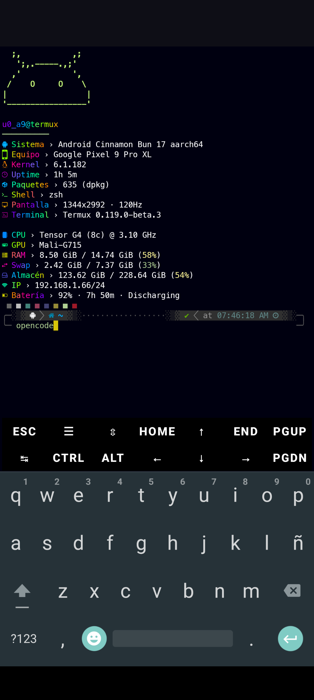
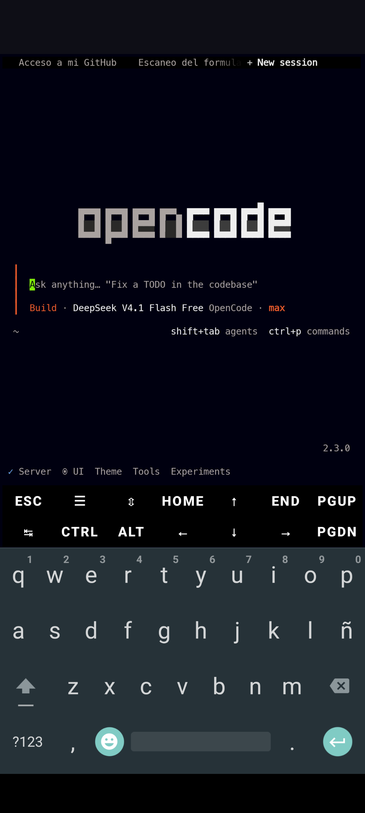
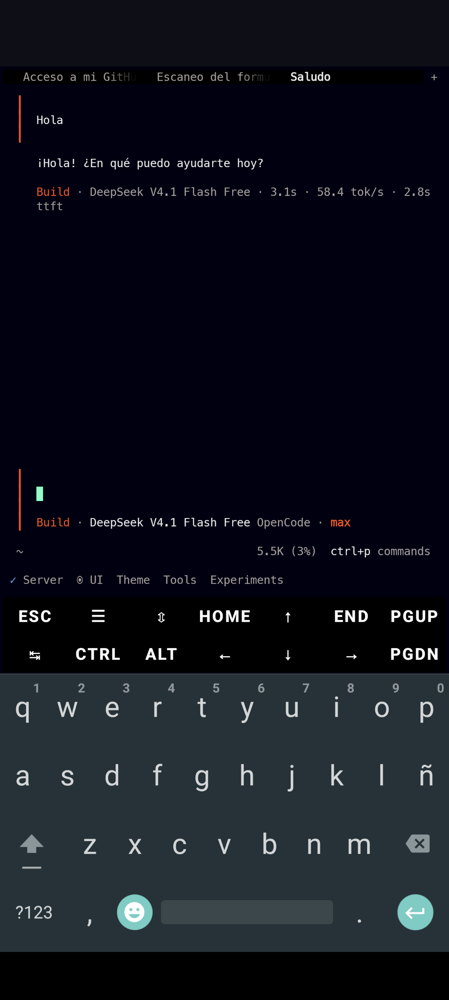
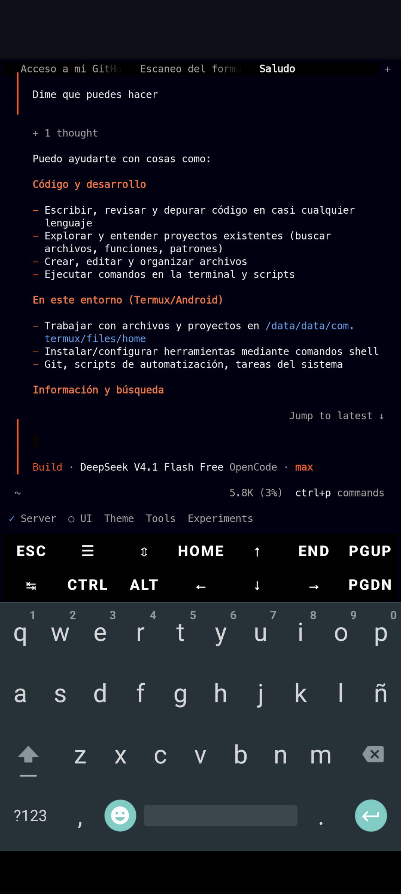

<!--
  Gardez ce document synchronisé avec README.md, README.es.md, README.en.md,
-->

<p align="center">
  
</p>

<h1 align="center">OpenCode pour Termux</h1>

<p align="center">
  <strong>Agent de programmation OpenCode assisté par IA, exécuté nativement sur Android avec Termux.</strong><br>
  Runtime Android/Bionic pour ARM64 et x86_64 · Vérification SHA-256 · Installation gérée
</p>

<p align="center">
  <a href="./README.md">Español</a> · <a href="./README.en.md">English</a> · <a href="./README.fr.md">Français</a>
</p>

<p align="center">
  <a href="https://github.com/C04-wq/opencode-termux/releases/latest"></a>
  <a href="https://github.com/C04-wq/opencode-termux/actions/workflows/validate.yml"></a>
  <a href="./LICENSE"></a>
</p>

<p align="center">
  <a href="#-à-propos-du-projet">Projet</a> ·
  <a href="#-prérequis">Prérequis</a> ·
  <a href="#-installation">Installation</a> ·
  <a href="#-mises-à-jour">Mises à jour</a> ·
  <a href="#-présentation-technique">Présentation technique</a> ·
  <a href="#-dépannage">Dépannage</a>
</p>

---

## 📱 À propos du projet

OpenCode est un agent de programmation open source fonctionnant dans le terminal. Ce dépôt le distribue pour Android Termux en utilisant l’environnement Bionic natif de Termux et Bun.

Le runtime est fourni sous forme de bundle JavaScript lancé par le Bun de Termux, avec OpenTUI, la bibliothèque partagée `bun-pty`, le daemon officiel `opencode-pty` compilé depuis `packages/process-daemon` et le module de surveillance des fichiers. Il n’exécute plus le binaire ELF Linux/musl d’origine et ne nécessite ni PRoot, ni machine virtuelle Linux, ni Node.js, ni npm sur l’appareil.

> [!IMPORTANT]
> Il s’agit d’une adaptation communautaire non officielle pour Termux. OpenCode est développé par anomalyco/opencode. Ce dépôt maintient l’installateur Termux, l’intégration, le mécanisme de mise à jour et les validations.

### Fonctionnalités principales

- Runtime Android/Bionic natif pour Termux ARM64/aarch64 et x86_64 (Android 9 / API 28 ou ultérieur).
- Bundle JavaScript exécuté par Bun avec OpenTUI, `bun-pty`, le daemon Rust officiel `opencode-pty` et la surveillance des fichiers, adaptés à Android/Bionic.
- Archive de release épinglée par SHA-256 et vérifiée avant extraction.
- Installation de bun, ripgrep et libc++ s’ils manquent ; la version de Bun doit correspondre à celle de la release.
- Programme de mise à jour intégré d’OpenCode activé et connecté aux releases vérifiées de ce dépôt.
- Commandes CLI officielles d’OpenCode, sans commandes de gestion supplémentaires.

## 📸 Captures d’écran

<p align="center">
  
  
</p>
<p align="center">
  
  
</p>

## ⚙️ Prérequis

| Prérequis | Détails |
| --- | --- |
| Appareil | Android 9 (API 28) ou ultérieur avec Termux |
| Architecture | ARM64 / aarch64 et x86_64 |
| Dépendances | Paquets Termux bun, ripgrep et libc++ (installés s’ils manquent) ; Bun doit conserver la même version majeure/mineure et atteindre au moins le correctif indiqué par la release |
| Outils | Bash, Git, curl, tar, sed et sha256sum |
| Fichiers Termux | Certificats CA et configuration du résolveur DNS |
| Réseau | Internet pour l’installation, les téléchargements épinglés, les vérifications de mise à jour et les fournisseurs d’IA |

L’installateur en une ligne nécessite que curl soit déjà installé. Il utilise pkg de Termux pour installer les dépendances et fichiers de support manquants.

### Environnements non pris en charge

ARM 32 bits, Android x86 32 bits, les shells Android autres que Termux, Linux de bureau, macOS et Windows ne sont pas pris en charge.

## 🚀 Installation

1. Installez et ouvrez Termux depuis une source fiable.
2. Ouvrez le terminal Termux.
3. Exécutez :

```bash
curl -fsSL https://raw.githubusercontent.com/C04-wq/opencode-termux/main/install.sh | bash
```

4. Lorsque l’installation est terminée, lancez OpenCode :

```bash
opencode
```

Vérifiez la version installée ou consultez les options :

```bash
opencode --version
opencode --help
```

### Que fait l’installateur ?

1. **Vérifie la plateforme.** Il accepte `uname -m` égal à `aarch64` ou `x86_64`.
2. **Prépare le dépôt du projet.** Pour une installation via un pipeline, il utilise `$PREFIX/opt/opencode-termux`. S’il trouve une copie propre de ce dépôt dans un emplacement courant sous le répertoire personnel Termux, il la met à jour et la déplace si possible vers l’emplacement géré.
3. **Protège le travail local.** Une copie contenant des fichiers modifiés ou non suivis n’est pas écrasée ; l’installateur s’arrête et demande de valider ou de mettre de côté les modifications.
4. **Prépare les dépendances.** Il installe avec `pkg` Git, curl, tar, coreutils, les certificats CA et la prise en charge du résolveur lorsqu’ils sont absents.
5. **Lit les métadonnées de release.** La version OpenCode attendue et le condensat SHA-256 de l’archive proviennent de `release-checksums.json`.
6. **Télécharge la release.** Il télécharge le bundle Android correspondant à l’architecture détectée depuis les GitHub Releases de ce dépôt via HTTPS.
7. **Vérifie le téléchargement.** Il calcule SHA-256 et refuse de continuer si le condensat ne correspond pas aux métadonnées épinglées.
8. **Valide le contenu de l’archive.** Il rejette les fichiers inattendus, entrées en double, traversées de chemins, liens dangereux et types de fichiers incorrects avant extraction.
9. **Prépare le bundle natif.** Il place le lanceur Bun, les modules JavaScript et les bibliothèques Android dans un emplacement temporaire.
10. **Active et teste.** Il installe le bundle natif et les lanceurs du projet, puis vérifie la version avec le Bun de Termux.
11. **Protège l’installation précédente.** L’ancien environnement et les anciens lanceurs sont conservés pendant l’activation et restaurés si l’activation ou le contrôle final échoue.

Les commandes réussies restent silencieuses afin de rendre la sortie lisible. En cas d’échec, leur sortie capturée est affichée pour faciliter le diagnostic.

### Installations existantes et gestion des conflits

L’installateur est volontairement prudent : il ne supprime pas une commande ou un paquet simplement parce que son nom contient « OpenCode ».

Il peut remplacer les installations reconnues lorsque leur propriété peut être établie :

- L’ancien paquet npm global `opencode` n’est supprimé que si ses métadonnées sont valides et si le lien symbolique `opencode` existant pointe à l’intérieur de ce paquet.
- Une liste restreinte de propriétaires de paquets Termux/dpkg est reconnue à partir des métadonnées de propriété : `opencode`, `opencode1`, `opencode`, `opencode-wrapper` et `opencode1-wrapper`.
- Un ancien lanceur géré par ce projet (`opencode`) est remplacé après reconnaissance de son contenu.

Si une commande existante est inconnue, copiée manuellement ou ne peut pas être attribuée en toute sécurité à l’une de ces installations, l’installateur s’arrête et n’y touche pas. Identifiez et supprimez cette installation vous-même uniquement après en avoir confirmé l’origine. Il n’effectue pas de nettoyage global de tous les fichiers portant un nom similaire (par exemple, des binaires `opencode2` arbitraires), des paquets npm sans rapport ou des répertoires étrangers au projet.

L’installateur ne supprime pas non plus les paramètres, sessions, projets ou identifiants des fournisseurs OpenCode.

### Emplacements d’installation

| Composant | Chemin |
| --- | --- |
| Copie du dépôt | `$PREFIX/opt/opencode-termux` |
| Environnement OpenCode et bibliothèques | `$PREFIX/lib/opencode-termux/` |
| Commande OpenCode | `$PREFIX/bin/opencode` |
| Marqueur de version installée | `$PREFIX/lib/opencode-termux/.opencode-termux-version` |
| SHA-256 du bundle installé | `$PREFIX/lib/opencode-termux/.opencode-termux-archive-sha256` |
| Marqueur du tag release installé | `$PREFIX/lib/opencode-termux/.opencode-termux-release-tag` |

Dans Termux, `$PREFIX` correspond généralement à `/data/data/com.termux/files/usr`. La seule commande publique installée est `opencode`.

Conservez la copie gérée du dépôt : l’installateur la réutilise pour récupérer les modifications avant de déployer le runtime.

## 🔄 Mises à jour

Le système officiel de détection et de notification des mises à jour d’OpenCode reste activé. Son service partagé de mise à jour est adapté pour consulter uniquement les releases vérifiées publiées par ce dépôt.

Lorsqu’OpenCode signale une nouvelle version, son invite habituelle permet de mettre à jour maintenant ou de reporter l’opération. Si vous choisissez la mise à jour, il consulte le fichier `release-checksums.json` de ce dépôt, sélectionne le paquet correspondant à l’architecture, vérifie le SHA-256 et exécute l’installateur de ce dépôt. Il ne consulte pas les releases officielles upstream d’OpenCode.

Vous pouvez également lancer le même flux officiel avec :

```bash
opencode update
```

`opencode update` et `opencode upgrade` utilisent le même service intégré. Le lanceur n’effectue aucune vérification périodique supplémentaire ni mise à jour silencieuse au démarrage.

Pour réparer ou réinstaller le runtime, relancez l’installateur :

```bash
curl -fsSL https://raw.githubusercontent.com/C04-wq/opencode-termux/main/install.sh | bash
```
## 🧩 Présentation technique

### Architecture du runtime

Le runtime est installé dans $PREFIX/lib/opencode-termux/lib/opencode et lancé par $PREFIX/lib/opencode-termux/bin/opencode. Le lanceur exécute le Bun de Termux. Le bundle contient des modules Android/Bionic pour OpenTUI, Rust PTY et @parcel/watcher.

Cette architecture remplace l’ancienne approche Linux/musl : l’installateur ne patche ni n’exécute plus de binaire ELF Linux. Les bibliothèques Android doivent être des objets partagés ELF de l’architecture cible (AArch64 ou x86-64, ET_DYN), sans dépendance à glibc.

### Source épinglée

Le pipeline de ce dépôt compile OpenCode à partir d’un commit épinglé du code source officiel (anomalyco/opencode). GitHub Actions compile OpenTUI, `bun-pty`, le daemon Rust officiel `opencode-pty` depuis `packages/process-daemon` et le watcher Android/Bionic, puis prépare le bundle JavaScript, inspecte les modules ELF et vérifie l’archive ainsi que son condensat SHA-256. tools/supply-chain-lock.json enregistre les révisions des sources et outils. L’installateur télécharge la release indiquée par release-checksums.json ; ces métadonnées resteront épinglées au runtime déjà vérifié jusqu’à ce que la nouvelle compilation réussisse les builds ARM64 et x86_64, les contrôles ELF, la validation des archives et les smoke tests automatisés dans la CI.

Le bundle comprend un lanceur shell, les modules JavaScript, le moteur de rendu Bionic OpenTUI, la bibliothèque partagée `bun-pty`, l’exécutable daemon officiel `opencode-pty` et un module Android de surveillance des fichiers.

### Installation et restauration

1. Vérifier que l’architecture est ARM64/aarch64 ou x86_64 et que la version minimale d’Android est respectée.
2. Installer avec pkg les dépendances manquantes : bun, ripgrep et libc++.
3. Télécharger par HTTPS le bundle Android épinglé et vérifier son SHA-256.
4. Valider les chemins et types des membres avant extraction ; rejeter le traversal, les liens et les fichiers spéciaux.
5. Remplacer le chemin de compilation par le chemin réel du runtime géré.
6. Préparer le bundle et conserver l’ancien runtime et les lanceurs jusqu’à l’activation du nouveau.
7. Exécuter --version et restaurer l’installation précédente en cas d’échec.


Le lanceur compare la version d’OpenCode, l’identifiant de génération du runtime et le SHA-256 du bundle installé. Cela détecte la migration musl vers Bionic ainsi qu’une reconstruction du bundle conservant la même version et la même génération.

Seules les commandes officielles d’OpenCode sont installées.

## 🔐 Sécurité et intégrité

- Les téléchargements utilisent HTTPS et sont vérifiés avec le condensat SHA-256 enregistré dans ce dépôt.
- Le dépôt source et le tag sont explicitement autorisés et doivent correspondre à la version épinglée.
- Les chemins et types de l’archive sont contrôlés avant extraction ; les liens symboliques, hardlinks, traversals et fichiers spéciaux sont rejetés.
- La CI vérifie que les modules natifs sont des bibliothèques ELF de l’architecture cible (AArch64 ou x86-64), sans dépendance à glibc.
- L’installateur n’écrase pas les commandes inconnues de Termux.
- L’activation du runtime et des lanceurs est transactionnelle ; l’installation précédente est restaurée si le contrôle final échoue.
- Le désinstallateur vérifie la propriété des fichiers avant leur suppression.

Limite de confiance : les révisions des sources et les outils de compilation sont épinglés et chaque artefact est vérifié, mais SHA-256 n’est pas une signature indépendante et ne remplace pas l’audit du code et de la chaîne de compilation. Les composants de compatibilité issus de tiers et leurs mentions de licence obligatoires sont documentés dans THIRD_PARTY_NOTICES.md.

## 🤖 Automatisation des releases et CI

Les workflows `check-upstream.yml` et `prepare-upstream-update.yml` vérifient toutes les six heures les tags stables officiels `vX.Y.Z` d’anomalyco/opencode et comparent les versions sémantiques entre toutes les versions majeures. Lorsqu’une nouvelle version apparaît, ils préparent une PR brouillon contenant le commit source exact et son SHA-256. Le workflow `validate.yml` construit et valide des bundles indépendants ARM64 et x86_64, inspecte leurs bibliothèques ELF, valide les deux archives et exécute des smoke tests automatisés. La préparation ne modifie pas `release-checksums.json` et ne publie aucune release automatiquement : le candidat doit être examiné et approuvé avant la création d’une release.

Les workflows `check-upstream.yml` et `prepare-upstream-update.yml` vérifient toutes les six heures les tags stables officiels `vX.Y.Z` d’anomalyco/opencode et comparent les versions sémantiques entre toutes les versions majeures. Lorsqu’une nouvelle version apparaît, ils préparent une PR brouillon avec le commit source exact et son SHA-256. Le workflow de validation construit les runtimes ARM64 et x86_64, inspecte leurs ELF, valide les deux archives et exécute des smoke tests. Les métadonnées d’installation ne sont pas modifiées et aucune release n’est publiée automatiquement : le candidat doit être examiné et approuvé avant publication. Il télécharge exactement la version et le tag définis dans release-checksums.json, vérifie SHA-256, inspecte les bibliothèques ELF Android et teste le lanceur avec un faux Bun contrôlé.

La CI construit et valide séparément les bundles ARM64 et x86_64, inspecte leurs bibliothèques ELF, valide les deux archives et exécute des smoke tests automatisés du runtime. Ces contrôles reproductibles constituent le critère d’acceptation pour les deux architectures et ne nécessitent pas d’appareils physiques. Des essais supplémentaires sur de vrais appareils restent utiles, mais ne bloquent pas la préparation automatisée.

Pour des essais manuels facultatifs sur appareil, téléchargez l’artefact GitHub Actions `android-arm64-candidate-*` ou `android-x86_64-candidate-*` correspondant et transmettez son archive à `scripts/test-termux-device.sh`. Il s’agit d’une validation supplémentaire, pas d’une condition pour l’acceptation CI automatisée. Le script installe le candidat dans un répertoire séparé sous `$PREFIX/opt` sans remplacer l’installation actuelle. Lancez ensuite le candidat et vérifiez la TUI interactive, le PTY, la surveillance des fichiers et le serveur en arrière-plan ; supprimez le répertoire candidat après les essais.

Les métadonnées d’installation ne sont modifiées qu’après validation de la compilation source, des ELF, de l’archive et du SHA-256. Ce projet ne compile ni ne publie plus l’exécutable Linux/musl incompatible.
## 🛠️ Dépannage

### `opencode: command not found`

Vérifiez que le lanceur géré existe, puis relancez l’installateur :

```bash
ls -l "$PREFIX/bin/opencode"
bash "$PREFIX/opt/opencode-termux/install.sh"
hash -r
opencode --version
```

Vous pouvez également relancer l’installateur curl en une ligne ; il détectera et réutilisera la copie gérée.

### `permission denied`

L’installateur applique le mode `755` au lanceur OpenCode après son installation. Relancez l’installateur :

```bash
bash "$PREFIX/opt/opencode-termux/install.sh"
ls -l "$PREFIX/bin/opencode"
```

### Architecture non prise en charge

Vérifiez l’architecture signalée par Termux :

```bash
uname -m
dpkg --print-architecture
```

L’appareil pris en charge doit indiquer `aarch64` ou `x86_64`. ARM 32 bits et x86 32 bits ne sont pas pris en charge.

### Erreurs de téléchargement, TLS ou DNS

Mettez à jour les paquets Termux et vérifiez l’accès à GitHub :

```bash
pkg update
pkg install git curl tar coreutils ca-certificates resolv-conf
curl -I https://github.com
```

L’installateur vérifie le bundle CA et la configuration du résolveur Termux. Ne contournez pas la vérification SHA-256 si un téléchargement échoue ou si le condensat ne correspond pas.

### La mise à jour ne peut pas avancer en fast-forward

Lorsque l’installateur réutilise la copie du dépôt, il la met à jour avec `git pull --ff-only`. En cas d’échec, inspectez la copie :

```bash
git -C "$PREFIX/opt/opencode-termux" status --short
```


Aucun minuteur de mise à jour périodique supplémentaire n’est ajouté par ce port. La détection et les notifications suivent la politique du programme de mise à jour intégré d’OpenCode.

Pour supprimer l’installation Termux gérée, lancez le désinstallateur :

```bash
bash "$PREFIX/opt/opencode-termux/uninstall.sh"
```

Le désinstallateur demande confirmation. Après confirmation, il supprime uniquement :
Après confirmation, il supprime uniquement :

- `$PREFIX/lib/opencode-termux` — l’environnement géré et ses marqueurs.
- `$PREFIX/bin/opencode` — le lanceur de ce projet.
- `$PREFIX/bin/opencode2` — uniquement s’il est identifié comme un ancien lanceur de ce projet.

Il vérifie le marqueur runtime et l’identité des lanceurs avant toute suppression. Si la propriété ne peut pas être établie, il s’arrête et laisse l’installation intacte.

**Le désinstallateur ne supprime pas :**

- La copie du dépôt dans `$PREFIX/opt/opencode-termux`.
- Les paquets Termux ou npm lui-même.
- Les paramètres, sessions, projets ou identifiants des fournisseurs OpenCode.
- Les autres binaires ou installations ne faisant pas partie de cet environnement géré.

Si vous souhaitez également supprimer les sources du projet, supprimez vous-même la copie après la désinstallation et après avoir vérifié qu’elle ne contient aucun travail à conserver.

## 🤝 Contribution

Les issues, rapports de bogues et pull requests sont les bienvenus. Veuillez aligner les modifications sur les cibles Termux ARM64 et x86_64 et ne pas affaiblir la validation des archives, la vérification des condensats, les contrôles de propriété ou le mécanisme de retour arrière.

### Validation locale

Depuis une copie du dépôt, exécutez les contrôles pertinents :

```bash
# Syntaxe shell
bash -n scripts/validate-runtime-archive.sh scripts/smoke-test-runtime-archive.sh

# Syntaxe et tests JavaScript
node --check scripts/test-native-runtime-contract.mjs
node scripts/test-native-runtime-contract.mjs

# Tests de régression shell
bash scripts/test-package-owner.sh
bash scripts/test-runtime-archive.sh

# Analyse statique (nécessite ShellCheck)
```

Le workflow GitHub Actions télécharge également le bundle Android épinglé, vérifie son condensat, inspecte les modules ELF et teste le contrat du lanceur.

### Directives de contribution

- Gardez la structure de l’archive release et les métadonnées de checksum cohérentes avec l’installateur et le validateur.
- N’introduisez pas de téléchargements non vérifiés et ne contournez pas les contrôles de checksum upstream ou du projet.
- Préservez le chemin du résolveur Termux, la configuration de l’interpréteur ELF et le comportement d’exécution directe requis par le serveur en arrière-plan d’OpenCode.
- Documentez dans ce README les changements de comportement visibles par l’utilisateur.
- N’incluez jamais de clés API, jetons d’accès, identifiants personnels ou données privées dans les commits ou rapports d’issue.

## 📄 Licence et remerciements

Ce dépôt est distribué sous la [licence MIT](./LICENSE).

[OpenCode](https://github.com/anomalyco/opencode) est un projet upstream distinct maintenu par [anomalyco](https://github.com/anomalyco). Ce dépôt ne revendique pas la propriété de l’application upstream. Consultez le dépôt upstream pour son code source, sa licence, ses releases et les avis du projet.
