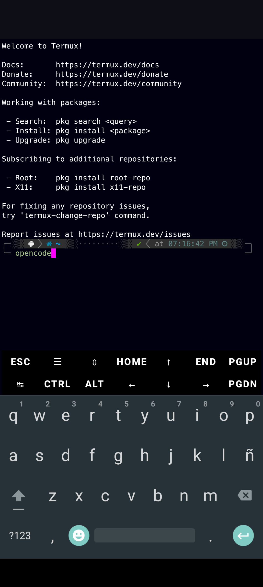
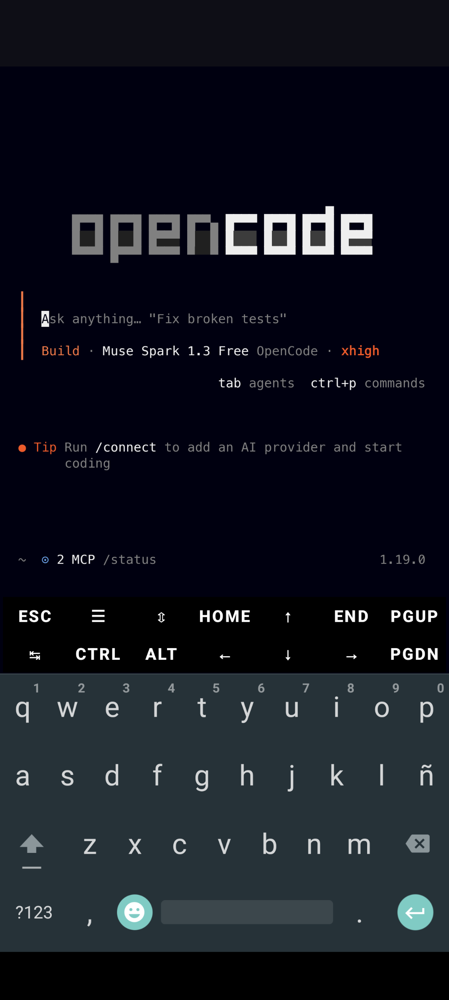
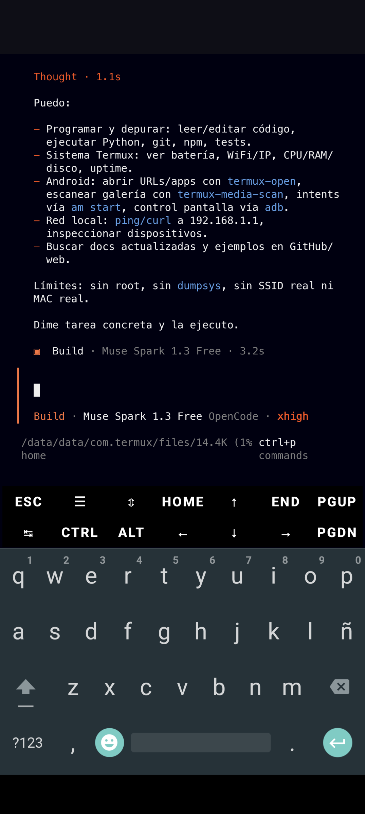
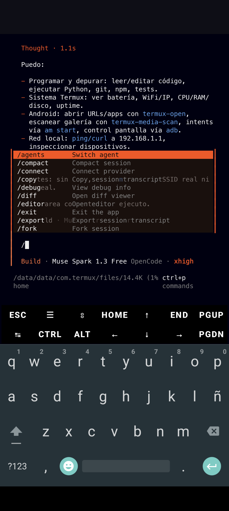

<!--
  Project documentation: keep installation paths, runtime behavior and CI claims
  aligned with install.sh, uninstall.sh, scripts/ and .github/workflows/.
-->

<p align="center">
  
</p>

<h1 align="center">OpenCode for Termux</h1>

<p align="center">
  <strong>Run OpenCode directly on Android with Termux.</strong><br>
  A verified ARM64 runtime, a Bash installer and consent-based updates — without Node.js or npm on your phone.
</p>

<p align="center">
  <a href="https://github.com/C04-wq/opencode-termux/releases/latest"></a>
  <a href="https://github.com/C04-wq/opencode-termux/actions/workflows/validate.yml"></a>
  <a href="https://github.com/C04-wq/opencode-termux/actions/workflows/release.yml"></a>
  <a href="./LICENSE"></a>
</p>

<p align="center">
  <a href="#installation">Installation</a> ·
  <a href="#updates">Updates</a> ·
  <a href="#how-it-works">How it works</a> ·
  <a href="#troubleshooting">Troubleshooting</a> ·
  <a href="#contributing">Contributing</a>
</p>

---

## Overview

[OpenCode](https://opencode.ai/) is an AI coding agent that runs in the terminal. This project packages the official Linux **ARM64 musl** release so it can run in **Android Termux**.

Android does not provide the same runtime environment as a conventional Linux distribution. This project supplies a compatible musl runtime, adjusts its DNS resolver path for Termux, and configures the OpenCode executable to use the bundled interpreter.

The result is a direct Termux installation managed with Bash and Git. There is no proot container, virtual machine, or Node.js/npm installation required on the Android device.

> **Project scope:** this repository provides the Termux packaging, runtime integration, installer and update mechanism. OpenCode itself is developed upstream by [anomalyco/opencode](https://github.com/anomalyco/opencode). This is a community-maintained, unofficial Termux package.

## Features

- **Android ARM64:** targets `aarch64` devices running Termux.
- **Upstream stable releases:** discovers the newest supported stable OpenCode version across major versions, including 1.x → 2.x transitions.
- **Verified downloads:** checks the release archive against the SHA-256 digest tracked in this repository before extraction.
- **Bundled runtime:** includes the musl loader and required runtime libraries; no `patchelf`, Node.js or npm is needed on the phone.
- **Termux networking:** builds musl with Termux's resolver path and configures the Termux CA certificate bundle at launch.
- **Consent-based updates:** checks for a newer package on interactive launches and asks before installing it.
- **Safe installation:** validates the archive and runtime before activation, keeps the previous runtime during replacement, and attempts to restore it if installation fails.
- **Preserved user data:** uninstalling removes only this project's runtime and launchers.

## Screenshots

<p align="center">
  
  
</p>
<p align="center">
  
  
</p>

## Requirements

| Requirement | Details |
| --- | --- |
| Device | Android with Termux |
| Architecture | **ARM64 / aarch64 only** |
| Network | Internet access for installation, provider access and update checks |
| Initial tools | curl (for the one-line command); Git is installed automatically if missing |
| Runtime tools | Bash, Git, curl, tar and `sha256sum` (provided by `coreutils`) |
| Termux system files | CA certificate bundle and resolver configuration |

The installer checks for missing runtime tools and uses Termux `pkg` to install the required packages, including Git, `ca-certificates` and `resolv-conf` when needed. The one-line command requires `curl` to be available before it starts.

**Not supported:** 32-bit ARM, x86, x86_64, or non-Termux Android environments.

## Installation

Open Termux and run this single command:

```bash
curl -fsSL https://raw.githubusercontent.com/C04-wq/opencode-termux/main/install.sh | bash
```

The installer prepares a persistent checkout at `$PREFIX/opt/opencode-termux`. If it finds an existing clean clone of this repository under your Termux home directory, it updates that clone and migrates it to the managed location instead of creating a duplicate. The old path disappears because the clone is moved, not because its contents are deleted. Git is installed automatically if needed.

If the existing clone contains local modifications or untracked files, the installer stops and leaves it untouched; commit or stash those changes before retrying. It never deletes unrelated Git repositories, project folders, OpenCode settings, sessions or provider credentials. Successful setup commands run quietly; full command output is shown if a step fails.

When replacing an older installation, the installer removes the global npm package `opencode-termux` only when its package metadata is valid and its installed `opencode` symlink resolves inside that package. It also recognizes a short allowlist of Termux/dpkg package names (`opencode`, `opencode1`, `opencode-termux`, `opencode-wrapper` and `opencode1-wrapper`) through package ownership metadata. Previous launchers from this project are replaced in place. If another or manually copied executable cannot be identified safely, installation stops and leaves it untouched; remove that installation yourself after confirming its origin. This avoids deleting an unrelated command just because it is named `opencode`.

When installation completes, start OpenCode:

```bash
opencode
```

Check the installed version and available commands:

```bash
opencode --version
opencode --help
```

### What the installer does

The installer reads the version and archive digest from [`release-checksums.json`](./release-checksums.json), then:

1. Checks that the device reports `aarch64`.
2. Installs missing Termux tools and required certificate/resolver files.
3. Downloads the matching `opencode-termux-aarch64.tar.gz` asset from this repository's GitHub Release over HTTPS.
4. Verifies the archive's SHA-256 digest. A mismatch stops installation.
5. Extracts and checks the expected runtime files.
6. Runs an OpenCode version smoke test using the bundled musl loader.
7. Activates the runtime under `$PREFIX/lib/opencode-termux`.
8. Installs the `opencode` launcher and `opencode-termux-update` updater under `$PREFIX/bin`.
9. Tests the installed executable again before reporting success.

The installer records the persistent checkout location in the runtime. For the one-line installation, this is `$PREFIX/opt/opencode-termux`. Keep that directory in place so the updater can find `install.sh` and the release metadata.

> **Provider access:** API access and provider credentials are not bundled with this package. Configure a supported provider in OpenCode using your own account or API key.

## Updates

Updates are designed to be deliberate: the launcher detects an available version, but it does not silently replace the installed runtime.

### Automatic update check

When `opencode` is launched from an interactive terminal, the launcher quietly requests the version metadata from the repository's `main` branch.

- If the metadata contains a newer version, a two-option menu appears.
- Choose **Install update now** to update the clone and reinstall the verified runtime.
- Choose **Wait for the next version** to continue with the installed version.
- If the network check fails or GitHub is unavailable, the current installation can still start.
- Successful Git update output is kept hidden; errors remain visible.
- Non-interactive launches do not display the update menu.

Use the **Up/Down** arrow keys and press **Enter** to confirm.

### Manual update

Run this command at any time:

```bash
opencode-termux-update
```

The updater runs a fast-forward-only `git pull` in the managed checkout at `$PREFIX/opt/opencode-termux` and then reruns `install.sh`. If the curl installer adopted an existing clone, this is the migrated checkout. The installer downloads the version pinned in `release-checksums.json` and verifies its SHA-256 digest before replacing the runtime.

Local Git changes that prevent a fast-forward are not overwritten; the update stops instead.

## How it works

The package combines the upstream OpenCode executable with a small, bundled musl runtime adapted for Termux.

1. **Upstream executable:** the build downloads the official `opencode-linux-arm64-musl.tar.gz` asset from [OpenCode releases](https://github.com/anomalyco/opencode/releases).
2. **Runtime libraries:** the package includes the musl loader, musl libc, libgcc and libstdc++ runtime files.
3. **Termux DNS:** the build uses musl 1.2.6 with its resolver configuration path adjusted to Termux's `$PREFIX/etc/resolv.conf`.
4. **ELF interpreter:** the build sets the executable's `PT_INTERP` to the installed bundled musl loader.
5. **Direct execution:** the launcher executes the OpenCode binary directly. This matters because OpenCode 2.x re-executes `/proc/self/exe` when starting its background server; invoking the loader as a wrapper would make that path refer to the loader instead of the OpenCode executable.
6. **Environment isolation:** the launcher clears inherited `LD_PRELOAD`, sets the Termux CA bundle, and adds the bundled runtime directory to `LD_LIBRARY_PATH`.
7. **Upstream self-update:** `OPENCODE_DISABLE_AUTOUPDATE=1` keeps OpenCode's own updater from replacing the Termux-managed runtime outside this project's verified installation flow.

### Installed paths

| Component | Location |
| --- | --- |
| OpenCode runtime | `$PREFIX/lib/opencode-termux/` |
| OpenCode command | `$PREFIX/bin/opencode` |
| Manual updater | `$PREFIX/bin/opencode-termux-update` |
| Installed version marker | `$PREFIX/lib/opencode-termux/.opencode-termux-version` |
| Original repository path | `$PREFIX/lib/opencode-termux/.opencode-termux-repo-dir` |
| Release version and checksum | `release-checksums.json` in the cloned repository |

## Release automation and validation

GitHub Actions maintain the package and check its compatibility:

| Workflow | Trigger | Purpose |
| --- | --- | --- |
| [Validate Termux installer](.github/workflows/validate.yml) | Pushes, pull requests and manual dispatch | Shell/Node syntax checks, metadata checks, resolver tests, toolchain-parser tests and ARM64 runtime smoke tests under QEMU |
| [Build and publish GitHub release](.github/workflows/release.yml) | Every 6 hours, relevant pushes to `main`, or manual dispatch | Finds the newest stable upstream release, builds the Termux archive, publishes release assets and updates checksum metadata |
| [Check toolchain updates](.github/workflows/toolchain-updates.yml) | Daily schedule, relevant pushes, pull requests or manual dispatch | Checks Alpine stable branches and opens a reviewable PR when the pinned build branch needs updating |

The release resolver:

- Compares stable semantic versions across all major versions.
- Excludes draft and prerelease releases.
- Requires the official ARM64 musl archive and a valid upstream SHA-256 digest.
- Fails rather than silently falling back to an older release if the newest stable release is missing the required asset or digest.

The release archive contains the OpenCode executable and its required runtime files. A matching `.sha256` asset is published with each release.

**Testing note:** CI uses ARM64 emulation with QEMU to inspect the archive and ELF interpreter, run `opencode --version`, and verify that `opencode serve` remains running during a smoke test. This is useful runtime coverage, but QEMU is not a substitute for testing every new release on a physical Android/Termux device.

Node.js is used by hosted GitHub Actions scripts only; it is not required on the Android device.

## Troubleshooting

### `opencode: command not found`

Run the installer again from its persistent checkout:

```bash
bash "$PREFIX/opt/opencode-termux/install.sh"
hash -r
opencode --version
```

You can also rerun the one-line curl command from any directory. It will detect and adopt an existing clean clone automatically.

### The installer reports an unsupported architecture

This package currently supports only ARM64. Check your device with:

```bash
uname -m
dpkg --print-architecture
```

Both should report `aarch64` on a supported Termux installation.

### Download, TLS or DNS errors

Update Termux packages and verify that GitHub is reachable:

```bash
pkg update
pkg install git curl tar coreutils ca-certificates
curl -I https://github.com
```

The installer also checks for the Termux resolver configuration and installs `resolv-conf` if it is missing. Do not bypass the SHA-256 check if a download fails or the digest does not match.

### The update cannot fast-forward

The updater deliberately uses `git pull --ff-only`. Check the clone for local changes before updating:

```bash
git -C ~/opencode-termux status --short
```

Commit, stash or otherwise resolve local changes, then run `opencode-termux-update` again.

### Shell commands behave incorrectly inside OpenCode

The current launcher clears Termux's inherited `LD_PRELOAD` before starting the bundled musl executable. Update to the latest repository version and reinstall:

```bash
opencode-termux-update
```

If the problem persists, open an [issue](https://github.com/C04-wq/opencode-termux/issues) with your Android version, the output of `uname -m`, the OpenCode version and the relevant error output.

## Uninstallation

Run the uninstaller from the persistent checkout:

```bash
bash "$PREFIX/opt/opencode-termux/uninstall.sh"
```

If the repository was migrated by the curl installer, use the managed checkout path shown above.

The uninstaller asks for confirmation, then removes only:

- `$PREFIX/lib/opencode-termux`
- `$PREFIX/bin/opencode`
- `$PREFIX/bin/opencode-termux-update`

It does **not** remove the cloned repository, Termux packages, OpenCode configuration, sessions, provider credentials or other user data. To remove the project source as well, delete the cloned repository yourself after uninstalling.

## Contributing

Issues and pull requests are welcome. Before submitting changes, run the local syntax checks and relevant tests:

```bash
bash -n install.sh uninstall.sh
bash -n scripts/build-android-release.sh scripts/setup-alpine-chroot.sh
node --check scripts/resolve-opencode-release.mjs
node --check scripts/check-toolchain-updates.mjs
node scripts/test-opencode-release-resolver.mjs
node scripts/test-toolchain-updates.mjs
```

Changes to the build process should preserve the archive layout, SHA-256 verification, Termux resolver path and direct ELF execution required by OpenCode's background server.

## License

This project is licensed under the [MIT License](./LICENSE).

OpenCode is a separate upstream project maintained by [anomalyco](https://github.com/anomalyco). Refer to its repository for OpenCode's own licensing and notices.
