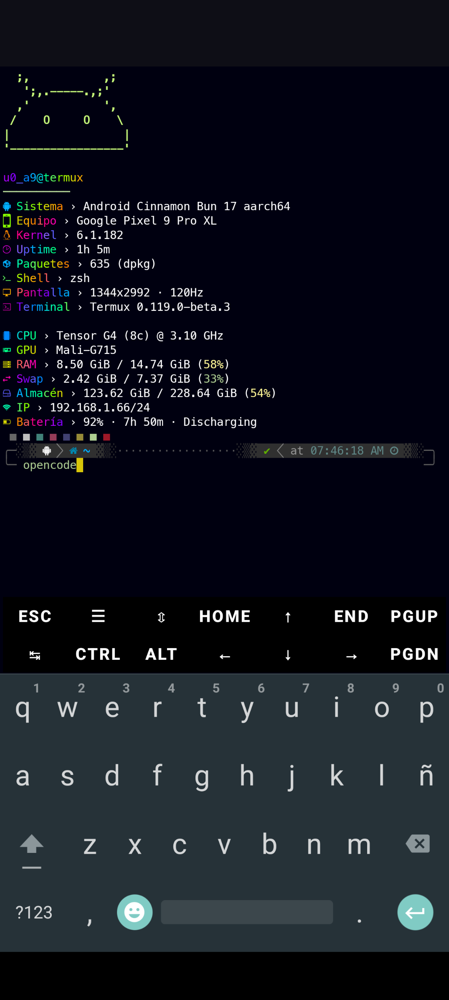
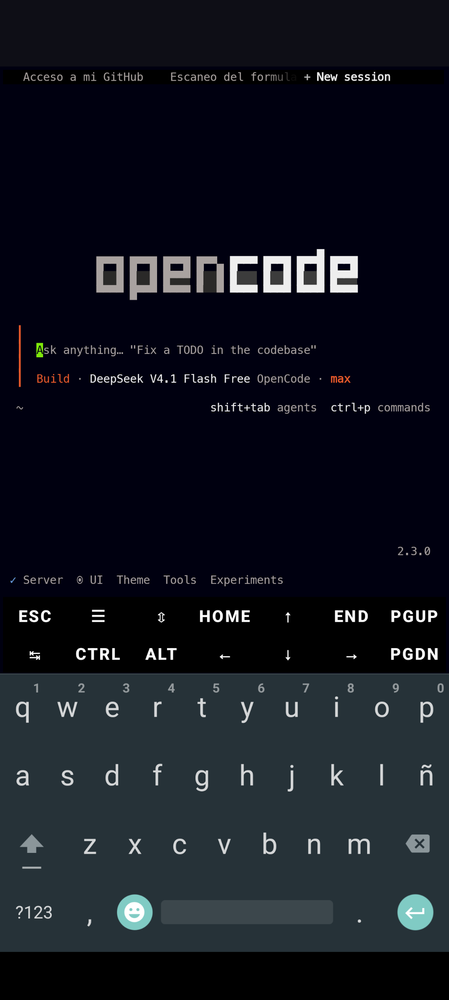
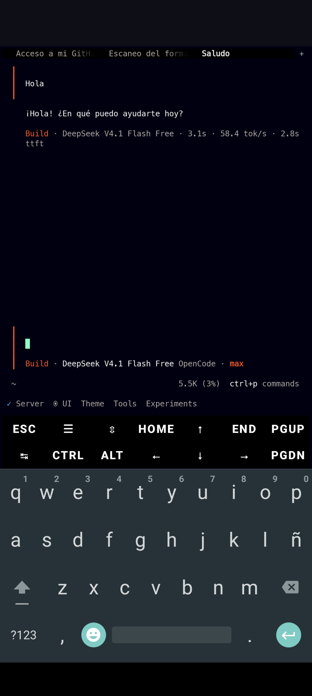
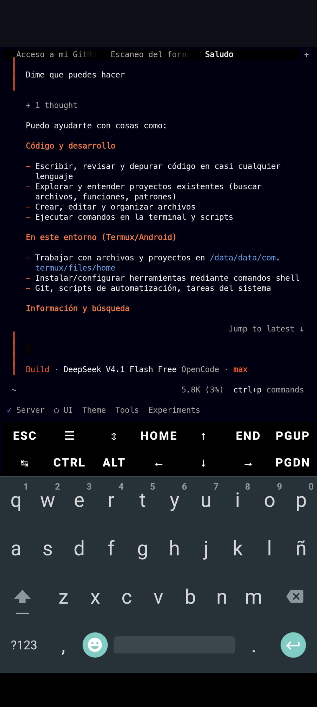

<!--
  Mantén este documento sincronizado con README.md, README.es.md, README.en.md, README.fr.md,
  install.sh, manager.sh, uninstall.sh, scripts/, release-checksums.json y .github/workflows/.
-->

<p align="center">
  
</p>

<h1 align="center">OpenCode para Termux</h1>

<p align="center">
  <strong>Agente de programación con IA OpenCode ejecutándose de forma nativa en Android mediante Termux.</strong><br>
  Runtime Android/Bionic para ARM64 y x86_64 · Verificación SHA-256 · Instalación gestionada
</p>


<p align="center">
  <a href="./README.md">Español</a> · <a href="./README.en.md">English</a> · <a href="./README.fr.md">Français</a>
</p>

<p align="center">
  <a href="https://github.com/C04-wq/opencode-termux/releases/latest"></a>
  <a href="https://github.com/C04-wq/opencode-termux/actions/workflows/validate.yml"></a>
  <a href="./LICENSE"></a>
</p>

<p align="center">
  <a href="#-acerca-del-proyecto">Proyecto</a> ·
  <a href="#-requisitos">Requisitos</a> ·
  <a href="#-instalación">Instalación</a> ·
  <a href="#-actualizaciones">Actualizaciones</a> ·
  <a href="#-cli-de-administración">CLI de administración</a> ·
  <a href="#-descripción-técnica">Descripción técnica</a> ·
  <a href="#-solución-de-problemas">Solución de problemas</a>
</p>

---

## 📱 Acerca del proyecto

OpenCode es un agente de programación con IA de código abierto que funciona en la terminal. Este repositorio lo empaqueta para Android Termux utilizando el entorno nativo Bionic de Termux y Bun.

El runtime se distribuye como un bundle JavaScript ejecutado por Bun de Termux, acompañado de OpenTUI, la biblioteca compartida `bun-pty`, el daemon oficial `opencode-pty` compilado desde `packages/process-daemon` y el módulo de vigilancia de archivos. Ya no ejecuta el binario ELF Linux/musl original y no requiere PRoot, una máquina virtual Linux, Node.js ni npm en el dispositivo.

> [!IMPORTANT]
> Esta es una adaptación comunitaria no oficial para Termux. OpenCode es desarrollado por anomalyco/opencode. Este repositorio mantiene el instalador de Termux, la integración, el gestor de actualizaciones y las validaciones.

### Características principales

- Runtime Android/Bionic nativo para Termux ARM64/aarch64 y x86_64 (Android 9 / API 28 o posterior).
- Bundle JavaScript basado en Bun con OpenTUI, `bun-pty`, el daemon oficial `opencode-pty` y vigilancia de archivos, todos adaptados a Android/Bionic.
- Release fijada mediante SHA-256 y validada antes de extraerla.
- Instalación automática de bun, ripgrep y libc++ si faltan.
- Menú interactivo con Install update now y Wait for the next version.
- CLI opencode-termux y sustitución transaccional del runtime con reversión en caso de error.

## 📸 Capturas de pantalla

<p align="center">
  
  
</p>
<p align="center">
  
  
</p>

## ⚙️ Requisitos

| Requisito | Detalles |
| --- | --- |
| Dispositivo | Android 9 (API 28) o posterior con Termux |
| Arquitectura | ARM64 / aarch64 y x86_64 |
| Dependencias | Paquetes Termux bun, ripgrep y libc++ (se instalan automáticamente si faltan) |
| Herramientas | Bash, Git, curl, tar, sed y sha256sum |
| Archivos de soporte | Certificados CA y configuración DNS de Termux |
| Red | Internet para instalar, descargar el bundle fijado, comprobar actualizaciones y acceder a proveedores de IA |

El instalador de una línea requiere que curl ya esté instalado. Utiliza pkg de Termux para instalar las dependencias y los paquetes de soporte que falten.

### Entornos no compatibles

No es compatible con ARM de 32 bits, Android x86 de 32 bits, shells Android distintos de Termux, Linux de escritorio, macOS ni Windows.

## 🚀 Instalación

1. Instala y abre Termux desde una fuente de confianza.
2. Abre la terminal de Termux.
3. Ejecuta:

```bash
curl -fsSL https://raw.githubusercontent.com/C04-wq/opencode-termux/main/install.sh | bash
```

4. Cuando termine el instalador, inicia OpenCode:

```bash
opencode
```

Comprueba la versión instalada o consulta las opciones:

```bash
opencode --version
opencode --help
```

### ¿Qué hace el instalador?

1. **Comprueba la plataforma.** Acepta `uname -m` igual a `aarch64` o `x86_64`.
2. **Prepara el repositorio del proyecto.** En una instalación canalizada utiliza `$PREFIX/opt/opencode-termux`. Si encuentra una copia limpia de este repositorio en una ubicación habitual dentro del directorio personal de Termux, la actualiza y, cuando es posible, la traslada a la ubicación gestionada.
3. **Protege los cambios locales.** Si la copia detectada contiene archivos modificados o sin seguimiento, no los sobrescribe: se detiene y solicita confirmar o guardar esos cambios.
4. **Prepara dependencias.** Instala mediante `pkg` Git, curl, tar, coreutils, certificados CA y soporte de resolución DNS cuando faltan.
5. **Lee los metadatos de la release.** La versión esperada de OpenCode y el hash SHA-256 del archivo proceden de `release-checksums.json`.
6. **Descarga la release.** Descarga el bundle Android correspondiente a la arquitectura detectada desde las GitHub Releases de este repositorio mediante HTTPS.
7. **Verifica la descarga.** Calcula SHA-256 y se niega a continuar si el hash no coincide con los metadatos fijados.
8. **Valida el contenido del archivo.** Rechaza archivos inesperados, entradas duplicadas, traversal de rutas, enlaces inseguros y tipos de archivo incorrectos antes de extraer.
9. **Prepara el bundle nativo.** Coloca el lanzador Bun, los módulos JavaScript y las bibliotecas Android en una ubicación temporal.
10. **Activa y prueba.** Instala el bundle nativo y los lanzadores del proyecto; después comprueba la versión mediante Bun de Termux.
11. **Protege la instalación anterior.** Conserva el entorno y los lanzadores previos durante la activación y trata de restaurarlos si falla la activación o la prueba final.

Los comandos que terminan correctamente se mantienen silenciosos para que la salida sea legible. Si alguno falla, se muestra su salida capturada para facilitar el diagnóstico.

### Instalaciones existentes y conflictos

El instalador es deliberadamente conservador: no elimina un comando o paquete solo porque su nombre contenga «OpenCode».

Puede reemplazar instalaciones reconocidas cuando puede establecer su propiedad:

- El paquete global npm heredado `opencode-termux` solo se elimina si sus metadatos son válidos y el enlace simbólico `opencode` existente apunta dentro de ese paquete.
- Se reconoce una lista limitada de propietarios de paquetes Termux/dpkg mediante sus metadatos: `opencode`, `opencode1`, `opencode-termux`, `opencode-wrapper` y `opencode1-wrapper`.
- Un lanzador anterior gestionado por este proyecto (`opencode`, `opencode-termux-update` u `opencode-termux`) se sustituye después de reconocer su contenido.

Si un comando existente es desconocido, se copió manualmente o no puede atribuirse con seguridad a una de esas instalaciones, el instalador se detiene y no lo modifica. Identifica y elimina esa instalación manualmente solo después de confirmar su origen. No realiza una limpieza indiscriminada de todos los archivos con nombres parecidos (por ejemplo, binarios arbitrarios `opencode2`), paquetes npm ajenos ni directorios no relacionados.

El instalador tampoco elimina la configuración, las sesiones, los proyectos ni las credenciales de proveedores de OpenCode.

### Rutas de instalación

| Componente | Ruta |
| --- | --- |
| Copia del repositorio | `$PREFIX/opt/opencode-termux` |
| Entorno OpenCode y bibliotecas | `$PREFIX/lib/opencode-termux/` |
| Comando OpenCode | `$PREFIX/bin/opencode` |
| CLI de administración | `$PREFIX/bin/opencode-termux` |
| Actualizador interno | `$PREFIX/bin/opencode-termux-update` |
| Marcador de versión instalada | `$PREFIX/lib/opencode-termux/.opencode-termux-version` |
| SHA-256 del bundle instalado | `$PREFIX/lib/opencode-termux/.opencode-termux-archive-sha256` |
| Marcador de ruta del repositorio | `$PREFIX/lib/opencode-termux/.opencode-termux-repo-dir` |

En Termux, `$PREFIX` normalmente corresponde a `/data/data/com.termux/files/usr`. El instalador asigna permisos de ejecución a los tres comandos instalados y comprueba que sean ejecutables antes de confirmar el éxito.

Conserva la copia gestionada del repositorio: el comando de actualización la utiliza para obtener cambios y volver a ejecutar el instalador.

## 🔄 Actualizaciones

Hay tres mecanismos relacionados de actualización y recuperación.

### 1. Actualización automática al iniciar OpenCode

Antes de iniciar una sesión normal, el lanzador ejecuta el actualizador gestionado como máximo una vez cada seis horas. El actualizador adelanta la copia Git mediante fast-forward y vuelve a ejecutar el instalador, que verifica los checksums del release y utiliza el reemplazo transaccional con recuperación.

- No se ejecuta para `opencode --version`, `opencode --help`, `opencode update` ni `opencode upgrade`.
- Se puede desactivar con `OPENCODE_TERMUX_AUTOUPDATE=0`.
- Los resultados se guardan en `$PREFIX/var/log/opencode-termux/auto-update.log`.
- Si falla la red o la actualización, el lanzador continúa con la versión instalada.

### 2. Actualizar manualmente el proyecto y el entorno

Para obtener el código más reciente del proyecto y reinstalar el entorno verificado:

```bash
opencode-termux update
```

Este comando ejecuta una actualización Git solo mediante fast-forward (`git pull --ff-only`) en la copia gestionada y después ejecuta su `install.sh`. Actualiza el gestor, el lanzador, el actualizador y el entorno según el repositorio y sus metadatos de release.

El actualizador establece la opción local de Git `core.filemode=false`. Así evita que diferencias exclusivas de permisos se consideren cambios de código en Termux, sin dejar de detectar modificaciones en el contenido.

Si los cambios locales o los archivos sin seguimiento impiden el fast-forward, la operación se detiene en lugar de sobrescribirlos. Inspecciona la copia:

```bash
git -C "$PREFIX/opt/opencode-termux" status --short
```

Confirma, guarda temporalmente o resuelve los cambios antes de volver a actualizar.

### 3. Volver a ejecutar el instalador para reparar la instalación

También puedes ejecutar de nuevo el instalador:

```bash
curl -fsSL https://raw.githubusercontent.com/C04-wq/opencode-termux/main/install.sh | bash
```

Detecta la copia gestionada y repite el procedimiento de instalación. Sirve para reparar lanzadores o permisos de ejecución ausentes, además de instalar la versión indicada por los metadatos de release de la copia local.

> **Importante:** el lanzador desactiva el actualizador propio de OpenCode mediante `OPENCODE_DISABLE_AUTOUPDATE=1`. Así se evita que el actualizador upstream sustituya el entorno gestionado por Termux fuera del proceso verificado de este proyecto.

## 🧰 CLI de administración

El instalador proporciona el comando independiente `opencode-termux`. Administra este paquete para Termux; no es la aplicación OpenCode.

Consulta la ayuda:

```bash
opencode-termux
# o
opencode-termux --help
```

### Comandos

| Comando | Forma con opción | Descripción |
| --- | --- | --- |
| `install` | `--install` | Instala o repara el entorno gestionado usando la copia existente. |
| `update` | `--update` | Actualiza la copia mediante fast-forward y reinstala el entorno verificado. |
| `uninstall` | `--uninstall` | Ejecuta el desinstalador del proyecto, que solicita confirmación. |
| `version` | `--version`, `-V` | Muestra la versión del gestor y la versión de OpenCode instalada, si existe. |
| `status` | `--status` | Indica si el entorno está instalado y muestra sus rutas principales. |
| `doctor` | `--doctor` | Comprueba arquitectura, dependencias, archivos, lanzadores, permisos, certificados, DNS e inicio del entorno. |
| `help` | `--help`, `-h` | Muestra la ayuda. |

Ejemplos:

```bash
opencode-termux status
opencode-termux version
opencode-termux doctor
opencode-termux update
```

### Diagnóstico con `doctor`

Ejecuta:

```bash
opencode-termux doctor
```

El diagnóstico comprueba:

- Que la arquitectura del dispositivo sea `aarch64` o `x86_64`.
- Que estén disponibles los comandos necesarios (`git`, `curl`, `tar`, `sha256sum`, `bun` y `rg`).
- Que esté instalada la biblioteca compartida libc++ de Termux.
- Que existan el lanzador nativo, el punto de entrada JavaScript, la biblioteca PTY y el módulo watcher.
- Que el lanzador nativo tenga permisos de ejecución.
- Que exista el marcador de versión y tenga un formato válido.
- Que el lanzador OpenCode corresponda al gestionado por el proyecto.
- Que el comando de administración exista, sea ejecutable y contenga el marcador de propiedad del proyecto.
- Que exista el actualizador interno y sea reconocible.
- Que estén presentes el paquete de certificados CA y la configuración DNS de Termux.
- Que el ejecutable instalado arranque e informe de la versión registrada en su marcador.

Muestra resultados individuales `OK` / `FAIL` y devuelve un código de salida distinto de cero si falla alguna comprobación. Es un diagnóstico local de la instalación: no valida claves API, cuentas de proveedores, acceso a todos los servicios de IA ni el estado del proyecto upstream.

## 🧩 Descripción técnica

### Arquitectura del runtime

El runtime se instala en $PREFIX/lib/opencode-termux/lib/opencode y se inicia mediante $PREFIX/lib/opencode-termux/bin/opencode. El lanzador ejecuta Bun de Termux. El bundle incluye módulos Android/Bionic para OpenTUI, Rust PTY y @parcel/watcher.

Esto sustituye el enfoque anterior basado en Linux/musl: el instalador ya no parchea ni ejecuta un binario ELF de Linux. Las bibliotecas Android deben ser objetos compartidos ELF de la arquitectura objetivo (AArch64 o x86-64, ET_DYN) y no deben depender de glibc.

### Origen fijado

El pipeline de este repositorio construye OpenCode desde un commit fijado del código fuente oficial (anomalyco/opencode). GitHub Actions compila OpenTUI, `bun-pty`, el daemon oficial Rust `opencode-pty` desde `packages/process-daemon` y el watcher para Android/Bionic, y prepara el bundle JavaScript, inspecciona los ELF y valida el archivo y su SHA-256. tools/supply-chain-lock.json registra los commits y versiones de las fuentes y herramientas. El instalador descarga la release indicada por release-checksums.json; esa metadata seguirá apuntando al runtime previamente verificado hasta que la nueva compilación supere las compilaciones, validaciones de ELF, pruebas de archivo y smoke tests automatizados de ARM64 y x86_64 en CI.

El bundle contiene un lanzador shell, los módulos JavaScript, el renderizador Bionic OpenTUI, la biblioteca compartida `bun-pty`, el ejecutable `opencode-pty` (daemon oficial de OpenCode) y un módulo Android para vigilar archivos.

### Instalación y reversión

1. Comprueba que la arquitectura sea ARM64/aarch64 o x86_64 y que se cumpla la versión mínima de Android.
2. Instala con pkg las dependencias que falten: bun, ripgrep y libc++.
3. Descarga por HTTPS el bundle Android fijado y verifica su SHA-256.
4. Valida las rutas y los tipos de los miembros antes de extraer; rechaza traversal, enlaces y archivos especiales.
5. Sustituye la ruta de compilación por la ruta real del runtime gestionado.
6. Prepara el bundle y conserva el runtime y los lanzadores anteriores hasta activar el nuevo.
7. Ejecuta --version y restaura la instalación anterior si falla.

Al elegir **Wait for the next version**, se guarda la versión, la generación del runtime y el SHA-256 exacto del bundle pendiente. El mismo bundle no vuelve a generar el aviso, pero una reconstrucción con el mismo número de versión y un hash diferente sí lo hará.

El lanzador compara la versión de OpenCode, el identificador de generación del runtime y el SHA-256 del bundle instalado. Así detecta tanto la migración desde musl como una reconstrucción del bundle que conserve la misma versión y generación.

El gestor, el actualizador, el menú interactivo y el desinstalador siguen separados del bundle de runtime.

## 🔐 Seguridad e integridad

- Las descargas utilizan HTTPS y se verifican contra el hash SHA-256 guardado en este repositorio.
- El repositorio de origen y la etiqueta están permitidos explícitamente y deben coincidir con la versión fijada.
- Las rutas y tipos del archivo se comprueban antes de extraer; se rechazan enlaces simbólicos, hardlinks, traversal y archivos especiales.
- CI comprueba que los módulos nativos sean bibliotecas ELF de la arquitectura objetivo (AArch64 o x86-64) y que no dependan de glibc.
- El instalador no sobrescribe comandos desconocidos de Termux.
- La activación del runtime y de los lanzadores es transaccional; se intenta restaurar la instalación anterior si falla la comprobación final.
- El desinstalador verifica la propiedad de los archivos antes de eliminarlos.

Límite de confianza: las fuentes y herramientas se fijan en el lockfile y cada artefacto se verifica, pero SHA-256 no es una firma independiente ni sustituye la auditoría del código y de la cadena de compilación. Los componentes de compatibilidad derivados de terceros y sus avisos de licencia obligatorios están documentados en THIRD_PARTY_NOTICES.md.

## 🤖 Automatización de releases y CI

Los workflows `check-upstream.yml` y `prepare-upstream-update.yml` consultan cada seis horas las etiquetas estables oficiales `vX.Y.Z` de anomalyco/opencode y comparan versiones semánticas entre todas las versiones principales. Si detectan una versión nueva, preparan un PR en borrador con el commit exacto y el SHA-256 de las fuentes. El workflow `validate.yml` compila y valida bundles independientes para ARM64 y x86_64, inspecciona los ELF, valida ambos archivos y ejecuta smoke tests automatizados. La preparación no modifica `release-checksums.json` ni publica automáticamente: hace falta revisar y aprobar el candidato antes de crear la release.

Los workflows `check-upstream.yml` y `prepare-upstream-update.yml` consultan cada seis horas las etiquetas estables oficiales `vX.Y.Z` de anomalyco/opencode, comparando versiones semánticas entre todas las versiones principales. Cuando aparece una versión nueva, preparan un PR en borrador con el commit exacto y el SHA-256 de las fuentes. El workflow de validación construye los runtimes ARM64 y x86_64, inspecciona sus ELF, valida ambos archivos y ejecuta smoke tests. No modifica los metadatos de instalación ni publica una release automáticamente: el candidato debe revisarse y aprobarse antes de publicar. Descarga exactamente la versión y etiqueta indicadas en release-checksums.json, verifica SHA-256, inspecciona las bibliotecas ELF Android y prueba el lanzador con un Bun de prueba controlado.

CI construye y valida bundles independientes para ARM64 y x86_64, inspecciona sus bibliotecas ELF, valida los archivos y ejecuta smoke tests automatizados del runtime. Estas pruebas reproducibles son la puerta de aceptación para ambas arquitecturas y no requieren disponer de dispositivos físicos. Las pruebas adicionales en dispositivos reales siguen siendo útiles, pero no bloquean la preparación automatizada.

Para probar manualmente un candidato en un dispositivo, descarga el artefacto correspondiente a `android-arm64-candidate-*` o `android-x86_64-candidate-*` de GitHub Actions y utiliza `scripts/test-termux-device.sh` con el archivo de esa arquitectura. Esto es una comprobación adicional, no un requisito para la validación automatizada. El script instala el candidato en un directorio separado bajo `$PREFIX/opt` y no sustituye tu instalación actual. Después inicia el candidato y comprueba la TUI interactiva, PTY, vigilancia de archivos y servidor; elimina el directorio candidato cuando termines.

La metadata de instalación solo cambia después de publicar una release cuya compilación, ELF, archivo y SHA-256 hayan pasado las verificaciones. Este proyecto ya no compila ni publica el ejecutable Linux/musl incompatible.
## 🛠️ Solución de problemas

### `opencode: command not found`

Comprueba si existe el lanzador gestionado y vuelve a ejecutar el instalador:

```bash
ls -l "$PREFIX/bin/opencode"
bash "$PREFIX/opt/opencode-termux/install.sh"
hash -r
opencode --version
```

También puedes volver a ejecutar el instalador curl de una línea; detectará y reutilizará la copia gestionada.

### `opencode-termux: command not found`

La CLI de administración se instala en `$PREFIX/bin/opencode-termux`. Comprueba que exista y que el directorio `bin` de Termux esté en tu `PATH`:

```bash
printf '%s\n' "$PATH"
ls -l "$PREFIX/bin/opencode-termux"
```

Después, vuelve a ejecutar el instalador para restaurar el gestor y sus permisos:

```bash
bash "$PREFIX/opt/opencode-termux/install.sh"
hash -r
opencode-termux --help
```

### `permission denied`

El instalador establece el modo `755` en el lanzador OpenCode, el gestor y el actualizador después de colocarlos en sus rutas definitivas. Vuelve a ejecutar el instalador:

```bash
bash "$PREFIX/opt/opencode-termux/install.sh"
ls -l "$PREFIX/bin/opencode" "$PREFIX/bin/opencode-termux" "$PREFIX/bin/opencode-termux-update"
```

### Arquitectura no compatible

Comprueba la arquitectura que informa Termux:

```bash
uname -m
dpkg --print-architecture
```

El dispositivo compatible debe informar `aarch64` o `x86_64`. No se admite ARM de 32 bits ni x86 de 32 bits.

### Errores de descarga, TLS o DNS

Actualiza los paquetes de Termux y comprueba el acceso a GitHub:

```bash
pkg update
pkg install git curl tar coreutils ca-certificates resolv-conf
curl -I https://github.com
```

El instalador comprueba el paquete CA y la configuración DNS de Termux. No omitas la verificación SHA-256 si falla una descarga o el hash no coincide.

### La actualización no puede hacer fast-forward

El actualizador utiliza intencionadamente `git pull --ff-only`. Inspecciona la copia:

```bash
git -C "$PREFIX/opt/opencode-termux" status --short
```

Confirma, guarda temporalmente o resuelve los cambios locales antes de volver a ejecutar `opencode-termux update`. El actualizador no fuerza un reset del repositorio.

### No aparece el menú interactivo de actualización

El menú solo aparece cuando se cumplen todas estas condiciones:

- OpenCode se inicia desde una terminal interactiva.
- El lanzador puede acceder a los metadatos de releases del repositorio.
- Los metadatos contienen una versión válida más reciente que la instalada.

Un cambio exclusivo del repositorio no implica necesariamente un cambio en la versión del entorno OpenCode. Para obtener directamente cambios del gestor o del instalador, utiliza:

```bash
opencode-termux update
```

### Los comandos de shell de OpenCode se comportan incorrectamente

El lanzador limpia el `LD_PRELOAD` heredado y configura la ruta de bibliotecas del entorno incluido. Primero actualiza el proyecto:

```bash
opencode-termux update
opencode-termux doctor
```

Si el problema continúa, abre un [issue](https://github.com/C04-wq/opencode-termux/issues) e incluye la versión de Android, `uname -m`, la versión de OpenCode, el comando afectado y el error completo. Elimina claves API, tokens y otros secretos de los registros antes de compartirlos.

## 🗑️ Desinstalación

Para eliminar la instalación gestionada de Termux:

```bash
opencode-termux uninstall
```

El desinstalador solicita confirmación. También puedes ejecutarlo directamente desde la copia del repositorio:

```bash
bash "$PREFIX/opt/opencode-termux/uninstall.sh"
```

Después de confirmar, elimina únicamente:

- `$PREFIX/lib/opencode-termux`: entorno gestionado y marcadores.
- `$PREFIX/bin/opencode`: lanzador de este proyecto.
- `$PREFIX/bin/opencode-termux-update`: actualizador interno.
- `$PREFIX/bin/opencode-termux`: CLI de administración.

Verifica el marcador del entorno y la identidad de los lanzadores antes de borrar archivos. Si no puede establecer la propiedad, se detiene y deja la instalación intacta.

**El desinstalador no elimina:**

- La copia del repositorio en `$PREFIX/opt/opencode-termux`.
- Paquetes Termux ni npm.
- Configuración, sesiones, proyectos ni credenciales de proveedores de OpenCode.
- Otros binarios o instalaciones que no formen parte de este entorno gestionado.

Si también quieres eliminar el código fuente del proyecto, borra la copia manualmente después de desinstalar y confirmar que no contiene trabajo que necesites.

## 🤝 Contribuir

Las incidencias, informes de errores y pull requests son bienvenidos. Mantén los cambios alineados con los objetivos Termux ARM64 y x86_64 y no debilites la validación del archivo, la verificación de hashes, las comprobaciones de propiedad ni la recuperación ante fallos.

### Validación local

Desde una copia del repositorio, ejecuta las comprobaciones pertinentes:

```bash
# Sintaxis de shell
bash -n install.sh uninstall.sh manager.sh opencode-termux
bash -n scripts/validate-runtime-archive.sh scripts/smoke-test-runtime-archive.sh

# Sintaxis y pruebas JavaScript
node --check scripts/test-native-runtime-contract.mjs
node scripts/test-native-runtime-contract.mjs

# Pruebas de regresión de shell
bash scripts/test-package-owner.sh
bash scripts/test-runtime-archive.sh

# Análisis estático (requiere ShellCheck)
shellcheck -S error install.sh uninstall.sh manager.sh opencode-termux scripts/*.sh
```

El workflow de GitHub Actions también descarga el bundle Android fijado, verifica su hash, inspecciona los módulos ELF y prueba el contrato del lanzador.

### Directrices de contribución

- Mantén sincronizado el punto de entrada del gestor (`opencode-termux`) con `manager.sh`.
- Mantén coherentes el formato del archivo release y los metadatos de hashes con el instalador y el validador.
- No introduzcas descargas sin verificar ni omitas las comprobaciones de integridad upstream o del proyecto.
- Conserva la ruta DNS de Termux, la configuración del intérprete ELF y el comportamiento de ejecución directa que necesita el servidor en segundo plano de OpenCode.
- Documenta en este README los cambios de comportamiento visibles para el usuario.
- Nunca incluyas claves API, tokens de acceso, credenciales personales ni datos privados en commits o informes.

## 📄 Licencia y agradecimientos

Este repositorio se distribuye bajo la [licencia MIT](./LICENSE).

[OpenCode](https://github.com/anomalyco/opencode) es un proyecto upstream independiente mantenido por [anomalyco](https://github.com/anomalyco). Este repositorio no reclama la propiedad de la aplicación upstream. Consulta el repositorio original para obtener su código fuente, licencia, releases y avisos del proyecto.
